# MangaZone — Modelo de Datos Conceptual Oficial

Este documento define el modelo de datos conceptual de MangaZone. Es la referencia obligatoria para diseñar posteriormente el esquema PostgreSQL y su representación en Prisma.

No es un `schema.prisma`, una migración ni una implementación. Los nombres de campos y entidades son conceptuales; cualquier traducción a código deberá contrastarse con:

1. `docs/MANGAZONE_MASTER_PLAN.md`.
2. `docs/SECURITY_ARCHITECTURE.md`.
3. `docs/TECHNICAL_ARCHITECTURE.md`.

Si una decisión marcada como abierta resulta necesaria para implementar el esquema, se debe detener esa implementación y solicitar aprobación.

## 1. Alcance y principios

La base de datos principal será una única instancia lógica de PostgreSQL. Prisma será el ORM y gestor de migraciones cuando se autorice su incorporación.

El modelo debe aplicar estos principios:

- Integridad referencial y restricciones en base de datos siempre que sean viables.
- Normalización razonable, sin una tabla genérica que mezcle dominios incompatibles.
- Relaciones explícitas para ownership, pertenencia y autoridad.
- Mínimo privilegio y autorización siempre en backend.
- Privacidad por defecto y separación entre datos almacenados y datos públicos.
- Historial inmutable o auditado cuando perderlo afectaría créditos, moderación o responsabilidades.
- Estados de ciclo de vida en lugar de borrado físico cuando el historial deba conservarse.
- `deletedAt` solo cuando represente una eliminación lógica real y tenga una política definida.
- Escalabilidad progresiva sin microservicios, múltiples bases de datos ni event sourcing prematuro.
- Datos demo del frontend y el prototipo visual no constituyen fuentes de datos de producción.

Conocer un identificador nunca concede acceso. Las restricciones de la base de datos complementan, pero no sustituyen, la autenticación y autorización de NestJS.

## 2. Convenciones generales

### 2.1 Nombres

- Entidades conceptuales: singular y `PascalCase`, por ejemplo `User`, `Manga` y `CommunityMember`.
- Campos conceptuales: `camelCase`.
- Las convenciones físicas de tablas y columnas se aprobarán al crear Prisma; deberán aplicarse de forma uniforme.
- Los enums se documentan en mayúsculas para distinguir sus valores de los textos mostrados al usuario.

### 2.2 Identificadores

Las entidades principales utilizarán **UUIDv7** generado de forma segura y compatible con PostgreSQL y Prisma.

- La primera migración funcional utiliza `@default(uuid(7)) @db.Uuid`: Prisma genera el UUIDv7 y PostgreSQL lo almacena en una columna nativa `uuid`.
- `uuid(7)` es un default de Prisma, no un default SQL visible en la base de datos; cualquier inserción que no pase por Prisma deberá proporcionar explícitamente un UUID válido conforme a la política del backend.
- UUIDv4 queda únicamente como fallback técnico si aparece una incompatibilidad concreta no prevista con UUIDv7.
- El mecanismo exacto de generación debe producir UUID válidos y no depender del frontend.
- Los IDs internos pequeños de catálogos cerrados podrán usar otra estrategia solo si existe una justificación concreta.
- Un UUID reduce enumeración trivial, pero no reemplaza controles contra IDOR/BOLA.
- Los recursos públicos usarán `slug` cuando sea útil para URLs legibles; el `slug` tampoco concede autorización.

### 2.3 Fechas y horas

- Guardar instantes en UTC mediante un tipo con zona horaria equivalente a `timestamptz`.
- `createdAt` y `updatedAt` pertenecen a entidades mutables relevantes.
- Usar campos específicos solo cuando expresen un evento real: `publishedAt`, `approvedAt`, `verifiedAt`, `suspendedAt`, `expiresAt`, `revokedAt`, `deletedAt`.
- Para reglas por “día”, como Cultivo, definir posteriormente la zona horaria de negocio; no inferirla del navegador.
- La hora de base de datos o backend será la autoridad, no una fecha enviada por el cliente.

### 2.4 Valores normalizados

Los valores usados para unicidad o búsqueda de coincidencias pueden necesitar una representación normalizada separada del texto visible:

- `usernameNormalized`.
- `emailNormalized`.
- `normalizedAlias`.
- `normalizedName` cuando corresponda.

Se conservará siempre el valor visible original. Email y username tendrán columnas normalizadas explícitas para búsqueda y unicidad case-insensitive. Los aliases tendrán una clave normalizada conservadora y podrán incorporar claves adicionales de búsqueda.

La normalización algorítmica exacta —Unicode, espacios, acentos, puntuación y caracteres permitidos— continúa pendiente. Nunca se debe sobrescribir el valor original que el usuario o el catálogo necesitan mostrar ni fusionar recursos automáticamente solo por una coincidencia normalizada.

### 2.5 Estados, enums y tablas configurables

Se adopta una estrategia híbrida:

- Estados técnicos y cerrados se representarán como enums, por ejemplo `UserStatus`, `MangaType`, `MangaStatus` y `ContentRating`.
- Catálogos administrables o extensibles se representarán como tablas, por ejemplo `Genre`, `Permission` y `Tag` cuando se apruebe su alcance.

Los enums cerrados implementados hasta la migración `011_moderation_deletion` se materializan como enums nativos de PostgreSQL mediante Prisma. La representación de cada enum futuro seguirá revisándose antes de su migración; los valores documentados aquí representan el dominio funcional obligatorio.

### 2.6 Slugs e historial

`Manga`, `ScanlationGroup` y `Community` tendrán un `slug` actual único y un historial de slugs anteriores.

El historial podrá representarse mediante entidades equivalentes a:

- `MangaSlugHistory`.
- `ScanlationGroupSlugHistory`.
- `CommunitySlugHistory`.

Cada registro histórico conservará como mínimo el slug anterior, el recurso de destino y la fecha del cambio. Los slugs históricos deben resolver hacia la URL actual y no deben reutilizarse inmediatamente.

Para `Manga`, la migración `003_catalog_base` adopta una tabla separada `MangaSlugHistory`: cada slug histórico es único y referencia un único manga mediante `RESTRICT`. PostgreSQL garantiza por separado la unicidad de `Manga.slug` y `MangaSlugHistory.slug`; mientras no exista un registro canónico compartido o un trigger autorizado, NestJS deberá comprobar ambas tablas dentro de la misma transacción al asignar o cambiar un slug. `ScanlationGroup` utiliza el mismo patrón mediante `ScanlationGroupSlugHistory` desde `006_scanlation_groups` y `Community` mediante `CommunitySlugHistory` desde `009_communities_posts`. El mecanismo común de exclusión entre slugs actuales e históricos de tablas distintas y el período temporal exacto de reserva continúan abiertos.

## 3. Ownership, autoridad y ciclo de vida

“Autor” o “propietario” no significa autoridad absoluta sobre un recurso. NestJS deberá validar identidad, rol, permisos, estado y relación con el recurso en cada operación.

| Recurso | Relación principal | Autoridad sobre estado o eliminación |
|---|---|---|
| `Profile`, ajustes, biblioteca, historial y listas | Pertenecen a un `User` | El usuario administra lo permitido; privacidad y eliminación se ejecutan en backend |
| `Manga` y `Chapter` | Catálogo de MangaZone | MangaZone/moderación de catálogo; un scanlation no es propietario de la obra |
| `ScanlationGroup` | Entidad con miembros y funciones internas | Miembros autorizados gestionan contenido; MangaZone verifica, suspende o cierra |
| `ScanlationProject` | Relaciona una obra con uno o varios grupos | Los grupos gestionan según su función; moderación resuelve continuidad y disputas |
| `Community` | Tiene propietario y miembros internos | Gestión interna limitada; moderación global conserva autoridad superior por permiso |
| `Post`, `PostComment`, `FanArt`, `Review` | Tienen autor | El autor puede editar según política; la eliminación se solicita y modera |
| `Conversation` y `Message` | Acceso por pertenencia | Solo participantes autorizados; moderación ve contexto limitado por un reporte |
| `Asset` | Tiene propietario opcional y recurso padre | El acceso se deriva del recurso y su política, no solo de `ownerUserId` |
| `ModerationAction` y auditoría | Registran al actor y objetivo | Registros append-only para Moderadores; no pueden borrar sus propios logs |

La pertenencia a un grupo o comunidad nunca equivale a un rol global de MangaZone. Nivel, reputación e insignias tampoco conceden autoridad.

## 4. Identidad, perfil y configuración

### 4.1 `User`

Representa la identidad de cuenta y el estado necesario para autenticación.

Campos conceptuales:

- `id`.
- `username` y `usernameNormalized`.
- `email` y `emailNormalized`.
- `passwordHash`.
- `emailVerifiedAt`.
- `status`.
- `createdAt`.
- `updatedAt`.
- `suspendedAt`, solo si resulta útil además del historial de sanciones.

Estados:

- `ACTIVE`.
- `PENDING_VERIFICATION`.
- `SUSPENDED`.
- `PENDING_DELETION`.
- `DELETED`.

Restricciones:

- Se conserva `username` visible y se aplica unicidad case-insensitive sobre `usernameNormalized`.
- Se conserva `email` original y se aplica unicidad case-insensitive sobre `emailNormalized`; nunca se expone públicamente.
- `username`/`usernameNormalized` y `email`/`emailNormalized` deben ser nulos o no nulos en pareja; la primera migración refuerza esta coherencia mediante `CHECK` de PostgreSQL.
- `email`, `emailNormalized` y `passwordHash` pueden ser nullable estructuralmente para soportar tombstones anonimizados y proveedores de autenticación futuros.
- Las cuentas locales activas deben tener las credenciales correspondientes; esta regla será validada por backend y, cuando sea viable, reforzada mediante constraints consistentes con el modelo de proveedores.
- Nunca se almacena una contraseña en texto plano ni mediante cifrado reversible como sustituto del hash.
- `User.status` representa el estado actual; `UserSanction` conserva el historial y alcance de sanciones.

### 4.2 `Profile`

Relación 1:1 con `User`, con `userId` único y clave foránea.

Campos conceptuales:

- `userId`.
- `displayName`.
- `bio`.
- `avatarAssetId` opcional.
- `bannerAssetId` opcional.
- `website` opcional.
- `socialLinks`, pendiente de estrategia.
- `createdAt` y `updatedAt` si el perfil se versiona o audita como entidad mutable.

Los mangas favoritos se derivarán de `LibraryEntry.isFavorite`. La representación de géneros favoritos continúa abierta. No se guardarán listas de IDs o nombres separadas por comas sin un contrato e integridad aprobados.

La primera migración aplica `ON DELETE RESTRICT` en `Profile.userId`. El flujo normal de eliminación conserva el `User` como tombstone; cualquier hard delete excepcional deberá purgar o anonimizar el perfil de forma explícita antes de eliminar la identidad, en lugar de depender de una cascada implícita.

La segunda migración incorpora `avatarAssetId` y `bannerAssetId` como FKs opcionales a `Asset`, ambas con `ON DELETE SET NULL`. Retirar físicamente un asset de forma excepcional no elimina el perfil; el flujo normal utiliza el estado del asset y permite sustituir sus referencias de forma explícita.

### 4.3 Configuración de usuario

Se recomienda separar la configuración por responsabilidad en vez de crear una tabla con cientos de columnas o un JSON sin contrato:

- `UserPrivacySettings` 1:1: visibilidad de perfil, biblioteca, actividad, historial, estado online, última conexión, seguidores y confirmaciones de lectura.
- `UserContentSettings` 1:1: contenido adulto habilitado, tratamiento de portadas y preferencias de contenido.
- `UserMessageSettings` 1:1: quién puede enviar solicitudes o mensajes y tratamiento de multimedia de desconocidos.
- `UserAppearanceSettings` 1:1: preferencias visuales que realmente deban sincronizarse.
- `NotificationPreference` N:1: categoría o evento, canal y estado habilitado; evita añadir una columna por cada notificación futura.
- `UserMutedCommunity` y `UserMutedTag`: relaciones explícitas para silencios.

Los valores predeterminados deben ser seguros: historial privado, +18 deshabilitado y recursos explícitos ocultos. Las tablas exactas de ajustes y el posible uso de JSON tipado para preferencias de baja criticidad quedan abiertos.

### 4.4 Favoritos de perfil

- `UserFavoriteGenre(userId, genreId, position?)` permanece como propuesta pendiente frente a otras representaciones validadas.
- Los mangas favoritos se integran en `LibraryEntry` como un atributo ortogonal al estado de lectura.

El orden opcional permite presentar una selección limitada sin duplicar la relación con el catálogo.

## 5. Datos de seguridad de cuenta

Los datos de seguridad deben quedar separados de `Profile` y nunca formar parte de una proyección pública.

### 5.1 `Session`

Almacena sesiones autenticadas. Solo se persiste el hash criptográfico (SHA-256 hex, exactamente 64 caracteres) del token opaco; el token original viaja exclusivamente en la cookie HttpOnly y nunca se almacena en base de datos.

Campos implementados:

- `id` UUIDv7, PK.
- `userId` UUID, FK a `User`, `ON DELETE CASCADE`.
- `tokenHash` VARCHAR(64), único. SHA-256 hex del token opaco.
- `createdAt` TIMESTAMPTZ, default `CURRENT_TIMESTAMP`.
- `lastUsedAt` TIMESTAMPTZ, default `CURRENT_TIMESTAMP`. Última actividad. El backend limita las escrituras actualizando solo tras una ventana mínima configurable.
- `expiresAt` TIMESTAMPTZ. Expiración absoluta (30 días por defecto, configurable).
- `revokedAt` TIMESTAMPTZ nullable. Si no es null, la sesión fue revocada.
- `userAgentSummary` VARCHAR(256) nullable. User-Agent truncado, sujeto a retención.
- `ipAddress` VARCHAR(45) nullable. IP del cliente, sujeta a retención. Solo procesada con trusted proxy explícito.

Índices: `(userId, revokedAt)` compuesto, `(expiresAt)`.

Constraints: `expiresAt > createdAt`, `revokedAt IS NULL OR revokedAt >= createdAt`.

No tiene `updatedAt`. Los campos mutables (`lastUsedAt`, `revokedAt`) tienen semántica propia.

Política de expiración: absoluta 30 días desde `createdAt` (configurable via `SESSION_MAX_AGE_DAYS`), inactividad 7 días desde `lastUsedAt` (configurable via `SESSION_IDLE_TIMEOUT_DAYS`). Una sesión es válida si `revokedAt IS NULL AND expiresAt > NOW() AND lastUsedAt > NOW() - IDLE_TIMEOUT AND User.status permite autenticación`.

Revocación: individual, global, inmediata al suspender o eliminar usuario, obligatoria tras password reset consumido, regeneración tras login o cambio de credenciales.

No se almacena un `csrfSecretHash`. El token CSRF se deriva statelessly como HMAC vinculado al `sessionId` sin exponerlo en texto. No se almacenan: token original, contraseñas, cookies completas, cabeceras HTTP completas ni fingerprint.

### 5.2 Tokens

#### 5.2.1 `EmailVerificationToken`

Token de un solo uso para verificar email tras registro. Solo se almacena el hash SHA-256.

Campos implementados:

- `id` UUIDv7, PK.
- `userId` UUID, FK a `User`, `ON DELETE CASCADE`.
- `tokenHash` VARCHAR(64), único.
- `expiresAt` TIMESTAMPTZ. 24 horas desde creación.
- `consumedAt` TIMESTAMPTZ nullable. Token utilizado correctamente.
- `invalidatedAt` TIMESTAMPTZ nullable. Token invalidado por emisión de uno nuevo o acción de seguridad.
- `createdAt` TIMESTAMPTZ, default `CURRENT_TIMESTAMP`.

Índices: `(userId)`, `(expiresAt)`.

Constraints: `expiresAt > createdAt`, `consumedAt IS NULL OR consumedAt >= createdAt`, `invalidatedAt IS NULL OR invalidatedAt >= createdAt`, `NOT (consumedAt IS NOT NULL AND invalidatedAt IS NOT NULL)` (exclusión mutua).

Un token es válido si `consumedAt IS NULL AND invalidatedAt IS NULL AND expiresAt > NOW()`. Al reenviar verificación, los tokens anteriores pendientes se marcan con `invalidatedAt = NOW()`; no se eliminan.

#### 5.2.2 `PasswordResetToken`

Token de un solo uso para restablecer contraseña. Solo se almacena el hash SHA-256.

Campos implementados:

- `id` UUIDv7, PK.
- `userId` UUID, FK a `User`, `ON DELETE CASCADE`.
- `tokenHash` VARCHAR(64), único.
- `expiresAt` TIMESTAMPTZ. 1 hora desde creación (ventana corta deliberada).
- `consumedAt` TIMESTAMPTZ nullable. Token utilizado correctamente.
- `invalidatedAt` TIMESTAMPTZ nullable. Token invalidado por emisión de uno nuevo o acción de seguridad.
- `createdAt` TIMESTAMPTZ, default `CURRENT_TIMESTAMP`.

Índices: `(userId)`, `(expiresAt)`.

Constraints: mismos 4 que EmailVerificationToken (expiresAt temporal, consumedAt temporal, invalidatedAt temporal, exclusión mutua).

Misma política de validez. Al consumir correctamente un PasswordResetToken, el backend revocará automáticamente todas las sesiones activas del usuario; no es opcional.

#### 5.2.3 `UserTwoFactorCredential` y `TwoFactorRecoveryCode`

Continúan pendientes. Se implementarán en una migration posterior. 2FA será obligatorio para Administradores y Moderadores antes de producción, conforme a SECURITY_ARCHITECTURE §10.

No se almacenan en ningún modelo de tokens: token original, email del usuario, contraseñas, hashes de contraseña ni secretos de sesión.

#### 5.2.4 `PasswordResetRequestJob`

Cola durable para gestionar de manera resiliente los requests de restablecimiento y reintentos (migration: `015_password_reset_request_queue`).
El total actual de migrations en el sistema es 15.

Conceptos y reglas:
- Relación opcional y única con `PasswordResetToken` (usado tras la emisión y confirmación de la base de datos).
- `status`: Estado del job (`PENDING`, `PROCESSING`, `COMPLETED`, `FAILED`).
- `attempts`: Número de intentos ejecutados.
- `availableAt`: Siguiente instante disponible para polling (respalda backoff y reintentos).
- `lease/lock`: Mecanismos `lockedAt` y `lockToken` para fencing.
- Material encriptado: El material confidencial (como la representación reversible para delivery) utiliza AES-256-GCM con AAD. El raw token nunca reside plaintext at rest en esta tabla.
- Redacción terminal: Al alcanzar `COMPLETED` o `FAILED`, el material confidencial del email se redacta (elimina) definitivamente.
- Purge: El registro completo se elimina 24 horas después de alcanzar estado terminal.

### 5.3 `SecurityAuditEvent`

Registro append-only de eventos sensibles de autenticación y seguridad de cuenta. Completamente separado de `ModerationAction`.

Campos implementados:

- `id` UUIDv7, PK.
- `userId` UUID nullable, FK a `User`, `ON DELETE SET NULL`. Null para intentos contra cuentas inexistentes.
- `eventType` TEXT. Validado en backend como constantes TypeScript, no como enum PostgreSQL.
- `ipAddress` VARCHAR(45) nullable. Sujeta a retención.
- `userAgentSummary` VARCHAR(256) nullable. Truncado.
- `metadata` JSONB nullable. Datos no sensibles adicionales.
- `createdAt` TIMESTAMPTZ, default `CURRENT_TIMESTAMP`.

Índices: `(userId, createdAt)` compuesto, `(eventType, createdAt)` compuesto, `(createdAt)`.

No tiene `updatedAt` ni `deletedAt`. La única operación de escritura es INSERT. UPDATE y DELETE están prohibidos en flujo normal. La limpieza por retención será un job administrativo futuro.
Tipos de evento V1 (lista representativa y no exhaustiva): `LOGIN_SUCCESS`, `LOGIN_FAILED`, `LOGOUT`, `LOGOUT_ALL`, `SESSION_REVOKED`, `SESSION_REVOKED_ALL`, `REGISTRATION`, `EMAIL_VERIFIED`, `PASSWORD_CHANGED`, `PASSWORD_RESET_REQUESTED`, `PASSWORD_RESET_COMPLETED`, `ACCOUNT_DELETION_REQUESTED`, `ACCOUNT_DELETION_CANCELLED`, `ACCOUNT_SUSPENDED`, `ACCOUNT_REACTIVATED`.

Los eventos técnicos `SESSION_REVOKED` y `SESSION_REVOKED_ALL` se generan siempre que una revocación afecte al menos una sesión. `LOGOUT` y `LOGOUT_ALL` quedan como eventos semánticos de AuthService.

Nunca se registran: contraseñas, tokens completos, hashes de contraseña, cookies, secretos, códigos 2FA, contenido de emails, cabeceras HTTP completas ni body de requests.

## 6. Roles y permisos globales

### 6.1 Entidades

- `Role(id, key, name, description)`.
- `Permission(id, key, description)`.
- `UserRole(userId, roleId, assignedByUserId, assignedAt, revokedAt?)`.
- `RolePermission(roleId, permissionId)`.

Roles principales iniciales:

- `USER`.
- `MODERATOR`.
- `ADMIN`.

Permisos granulares iniciales, entre otros:

- `moderate.communities`.
- `moderate.fanart`.
- `moderate.scanlations`.
- `moderate.adult`.
- `moderate.users`.
- `moderate.catalog`.
- `moderate.reports`.

Para permitir que dos Moderadores tengan permisos distintos sin crear un rol nuevo para cada combinación, se adopta `UserPermissionGrant(userId, permissionId, grantedByUserId, grantedAt, revokedAt?)`. `RolePermission` aporta permisos por rol y `UserPermissionGrant` concede permisos explícitos y auditables por usuario.

No se contempla una denegación explícita por usuario en V1 salvo que una política futura la justifique; mezclar concesiones y denegaciones aumenta la complejidad. El Administrador posee todos los permisos según una política de backend inequívoca y auditada.

Toda asignación, revocación o cambio debe generar auditoría. Grupo verificado, roles de scanlation y roles de comunidad se modelan fuera de estas tablas.

En la primera migración, las relaciones RBAC aplican `CASCADE` solo cuando una asociación positiva deja de tener sentido tras un hard delete excepcional de su usuario sujeto. Las referencias a `Role` y `Permission` usan `RESTRICT`, y los actores opcionales `assignedByUserId` y `grantedByUserId` usan `SET NULL`. El tombstone continúa siendo el flujo normal para usuarios eliminados.

## 7. Catálogo de Manga, Manhwa y Manhua

### 7.1 `Manga`

Entidad canónica de una obra.

Campos conceptuales:

- `id`.
- `slug`.
- `title`.
- `originalTitle` opcional.
- `type`.
- `status`.
- `contentRating`.
- `description`.
- `coverAssetId` opcional.
- `publicationYear` opcional.
- `createdAt`.
- `updatedAt`.

Tipos:

- `MANGA`.
- `MANHWA`.
- `MANHUA`.

Estados editoriales:

- `ONGOING`.
- `COMPLETED`.
- `PAUSED`.
- `CANCELLED`.
- `UNKNOWN`.

Clasificación de contenido:

- `GENERAL`.
- `TEEN`.
- `MATURE`.
- `ADULT`.

`contentRating` será la única fuente persistida de clasificación. No se persistirá un `isAdult` redundante; podrá derivarse mediante `contentRating === ADULT`. La autorización +18 depende además de sesión, preferencias y políticas legales.

La puntuación pública debe derivarse de `Review` o de agregados reconstruibles. Las estadísticas de alto tráfico podrán materializarse en el futuro, pero no deben convertirse prematuramente en una segunda fuente de verdad.

En la migración `003_catalog_base`, `publicationYear` se representa como entero nullable y se limita a valores positivos cuando existe. `coverAssetId` es nullable y usa `SET NULL` ante un hard delete extraordinario del asset; el ciclo normal de un archivo continúa gobernado por `Asset.status`.

### 7.2 `MangaAlias`

Relación N:1 con `Manga`.

Campos:

- `id`.
- `mangaId`.
- `alias`.
- `normalizedAlias`.
- `languageCode` opcional.
- `aliasType` opcional, por ejemplo original, romanizado o alternativo.

Cada alias conservará su valor original y una clave normalizada conservadora. Se aplicará unicidad de `(mangaId, normalizedAlias)`. `normalizedAlias` debe indexarse para buscar coincidencias, pero no debe ser globalmente único porque dos obras distintas pueden compartir un nombre legítimo. La detección podrá utilizar claves adicionales de búsqueda. La creación de una obra requiere revisión de coincidencias: una normalización nunca fusionará mangas automáticamente.

### 7.3 Creadores

Se adopta una entidad unificada `Creator` y una relación `MangaCreator`:

- `Creator(id, name, normalizedName, biography?, createdAt, updatedAt)`.
- `MangaCreator(mangaId, creatorId, contributionType, position?)`.

Tipos de contribución iniciales:

- `AUTHOR`.
- `ARTIST`.
- `STORY`.
- `ILLUSTRATION`.

Este modelo evita duplicar a una persona que participa como autor y artista, admite varios creadores por obra y conserva el tipo de aporte en la relación. No se separarán `Author` y `Artist` como identidades incompatibles.

Restricción: `(mangaId, creatorId, contributionType)` único. Los nombres de creadores no deben asumirse globalmente únicos sin una política de desambiguación.

La migración `003_catalog_base` no materializa `position`: se añadirá únicamente si un requisito futuro demuestra que el orden de créditos debe persistirse. `Creator.normalizedName` se indexa para detección y búsqueda, pero no es único.

### 7.4 Géneros

- `Genre(id, slug, name, description?, isActive)`.
- `MangaGenre(mangaId, genreId, isPrimary?)`.

Restricciones:

- `Genre.slug` único.
- `(mangaId, genreId)` único.
- Si se permite un género principal, como máximo uno por manga; la implementación exacta debe usar una restricción o transacción segura.

No se guardarán géneros en un string separado por comas.

La migración `003_catalog_base` conserva el núcleo administrable `Genre` y la relación `MangaGenre`. Evita todavía `isActive` e `isPrimary` hasta que se aprueben sus reglas operativas; `Genre.slug` y `Genre.name` son únicos, `(mangaId, genreId)` es la clave compuesta, eliminar un manga limpia la asociación y eliminar un género referenciado queda restringido.

### 7.5 Personajes

`Character` permitirá relacionar Fan-Art con personajes y obras. Continúa pendiente decidir si cada personaje pertenece inicialmente a un único `Manga` o si utiliza una identidad global con una relación N:M. Tampoco se asumirá unicidad global por nombre.

## 8. Capítulos, publicaciones y páginas

### 8.1 `Chapter`

Representa un capítulo lógico de una obra.

Campos conceptuales:

- `id`.
- `mangaId`.
- `kind`.
- `number` decimal opcional.
- `displayLabel`.
- `title` opcional.
- `sortOrder`.
- `status`.
- `createdAt`.
- `updatedAt`.

Estados del capítulo lógico:

- `DRAFT`.
- `ACTIVE`.
- `HIDDEN`.
- `ARCHIVED`.

No se utilizará un entero ni un string como única representación. Se adopta la separación entre:

- `kind`, con valores conceptuales iniciales como `REGULAR`, `SPECIAL`, `EXTRA` y `ONE_SHOT`.
- `number` decimal opcional para `0`, `1`, `12` o `12.5`.
- `displayLabel` para la representación visible, por ejemplo `12.5`, `Especial` o `One-shot`.
- `sortOrder` para ordenar capítulos numerados y no numerados de forma determinista.

Ejemplos aprobados:

| Caso | `kind` | `number` | `displayLabel` | `sortOrder` |
|---|---|---:|---|---:|
| Capítulo 12 | `REGULAR` | `12` | `12` | `12` |
| Capítulo 12.5 | `REGULAR` | `12.5` | `12.5` | `12.5` |
| Especial | `SPECIAL` | `null` | Etiqueta apropiada | Valor definido |
| One-shot | `ONE_SHOT` | `null` | `One-shot` | Valor definido |

La migración `004_chapters_releases` representa `number` y `sortOrder` como `numeric(12,4)`. `number` es nullable y admite cero; cuando existe no puede ser negativo. `sortOrder` es obligatorio y no negativo.

El UUIDv7 de `Chapter.id` es la identidad canónica. Sin añadir `chapterKey`, la base evita duplicados exactos mediante `(mangaId, kind, number)`, `(mangaId, kind, displayLabel)` y reserva una única posición mediante `(mangaId, sortOrder)`. PostgreSQL permite múltiples `NULL` en la primera constraint, por lo que especiales, extras y one-shots no numerados se distinguen por tipo, etiqueta visible y orden. La normalización futura de `displayLabel`, el tratamiento de volúmenes y cualquier ampliación de precisión continúan siendo reglas de backend o migraciones posteriores.

`Manga → Chapter` utiliza `ON DELETE RESTRICT`: un manga con capítulos no puede eliminarse físicamente por cascada. Los estados cubren el retiro normal y cualquier purga excepcional deberá ser explícita y protegida.

### 8.2 Publicaciones o versiones de capítulo

Los requisitos permiten que varios grupos trabajen sobre una obra e incluso colaboren. Se adopta la distinción:

- `Chapter`: capítulo lógico del catálogo.
- `ChapterRelease`: publicación o versión alojada/autorizada dentro de MangaZone.

`ChapterRelease` puede contener:

- `id`.
- `chapterId`.
- `projectId` opcional.
- `language`.
- `status`.
- `uploadedByUserId` opcional.
- `publishedAt` opcional.
- `createdAt` y `updatedAt`.

Estados iniciales de la publicación:

- `DRAFT`.
- `PENDING_REVIEW`.
- `PUBLISHED`.
- `HIDDEN`.
- `WITHDRAWN`.

`language` se almacena como `varchar(35)` y se validará como etiqueta BCP 47 en backend. `publishedAt` no recibe `now()` automáticamente. Puede existir más de una release para el mismo capítulo e idioma; no se impone unicidad `(chapterId, language)` porque futuras revisiones, grupos y colaboraciones requieren varias publicaciones.

Esto evita mezclar páginas distintas de varios grupos o colaboraciones en el mismo capítulo. `Chapter` y `ChapterRelease` tienen ciclos de vida separados. La FK al capítulo usa `RESTRICT` y `uploadedByUserId` usa `SET NULL` ante un hard delete excepcional del usuario. El uploader representa procedencia técnica, no copyright, propiedad ni necesariamente un crédito público `UPLOADER`.

La migración `008_release_groups_credits` añade `projectId` como FK nullable a `ScanlationProject` con `RESTRICT`. Una release puede no pertenecer a un proyecto, por ejemplo ante una publicación independiente, editorial autorizada o migración histórica futura. Cuando existe proyecto, NestJS deberá comprobar transaccionalmente que el manga de `ChapterRelease.chapterId` coincide con `ScanlationProject.mangaId`; no se duplica `mangaId` en la release únicamente para forzar una FK compuesta artificial.

`ChapterReleaseGroup(chapterReleaseId, groupId, createdAt)` registra uno o varios grupos participantes. Su PK compuesta evita duplicar un grupo en la misma release y no incorpora `PRIMARY`, `COLLABORATOR` ni `primaryGroupId`: todos son participantes y la relación no expresa propiedad exclusiva. La FK hacia la release usa `CASCADE` solo ante su hard delete extraordinario; la FK al grupo usa `RESTRICT` para conservar atribución histórica. Cuando existe `projectId`, el backend debe comprobar que el grupo estaba autorizado o participaba en el proyecto en el momento de publicación; esa condición temporal no se fuerza mediante una FK frágil hacia una participación activa.

`ChapterCredit` pertenece siempre a `ChapterRelease`, nunca al capítulo lógico. Los créditos y grupos asociados describen metadata operativa e histórica de MangaZone; no prueban licencia, copyright, autorización editorial ni derechos sobre la obra. Un grupo `VERIFIED` continúa significando únicamente “Grupo verificado por MangaZone”.

### 8.3 `ChapterPage`

Cuando MangaZone aloje contenido autorizado:

- `id`.
- `chapterReleaseId`.
- `pageNumber`.
- `assetId`.
- `createdAt`.

Restricción: `(chapterReleaseId, pageNumber)` único y `pageNumber > 0`. `ChapterPage` pertenece siempre a una publicación concreta. Las páginas deben ordenarse por `pageNumber` y los binarios viven en Object Storage, nunca en PostgreSQL. No duplica `width` ni `height`, porque esa metadata ya pertenece a `Asset`.

La FK a `ChapterRelease` usa `CASCADE` porque la página es una dependencia pura de la release. La FK a `Asset` usa `RESTRICT`: un asset referenciado no puede eliminarse físicamente; el retiro normal se representa mediante `Asset.status`.

## 9. Assets y archivos

### 9.1 `Asset`

Representa metadata de un archivo, no el binario.

Campos conceptuales:

- `id`.
- `storageKey`.
- `mimeType` validado.
- `sizeBytes`.
- `width` y `height` opcionales.
- `status`.
- `ownerUserId` opcional.
- `createdAt`.
- `updatedAt` cuando exista procesamiento.

La segunda migración utiliza `bigint` para `sizeBytes`, con un `CHECK` no negativo. `width` y `height` son `integer` opcionales y, cuando existen, deben ser positivos. `storageKey` es único, opaco y generado por el servidor; no debe derivarse de forma confiada del nombre entregado por el usuario.

No se almacenan en esta fase `originalFilename`, `contentHash`, `durationMs`, `kind`, `accessLevel` ni URLs públicas, CDN o firmadas. `originalFilename` puede contener PII y no se justifica sin una política privada; un hash futuro requerirá algoritmo, formato y pipeline definidos. Tipos como avatar, banner, cover, Fan-Art, page, image, GIF y video se incorporarán cuando un recurso real los necesite.

Estados posibles:

- `PENDING`.
- `QUARANTINED`.
- `READY`.
- `REJECTED`.
- `DELETED`.

Niveles conceptuales:

- `PUBLIC`.
- `PROTECTED`.
- `PRIVATE`.

`storageKey` debe ser único y generado por el sistema. No se guardará como fuente de verdad una URL pública permanente, porque el dominio, CDN o nivel de acceso pueden cambiar.

`ownerUserId` es opcional y representa procedencia o auditoría. El acceso efectivo se deriva del recurso padre, de sus permisos, de la sesión y de la política +18. Ser propietario o uploader del `Asset` no concede automáticamente permiso para publicarlo.

La FK `ownerUserId` utiliza `ON DELETE SET NULL`: el tombstone sigue siendo el flujo normal de usuario, pero un hard delete extraordinario no arrastra assets históricos. `READY` describe disponibilidad técnica, no visibilidad pública ni autorización.

El MIME declarado por el cliente nunca será autoridad. El futuro pipeline deberá comprobar tipo real, tamaño, dimensiones, nombre seguro generado por servidor, ausencia de permisos de ejecución, cuarentena, recodificación y análisis antimalware cuando corresponda. Las credenciales de almacenamiento nunca se exponen al cliente.

Los derivados procesados podrán modelarse posteriormente como assets relacionados; no se diseña ahora un pipeline de uploads.

## 10. Biblioteca, lectura y listas

### 10.1 `LibraryEntry`

Relación entre `User` y `Manga`.

Campos:

- `userId`.
- `mangaId`.
- `status`.
- `isFavorite`.
- `createdAt`.
- `updatedAt`.

Estados:

- `READING`.
- `PLAN_TO_READ`.
- `ON_HOLD`.
- `COMPLETED`.
- `DROPPED`.

La migración `005_library_reading_lists` utiliza `(userId, mangaId)` como clave primaria compuesta; no añade un identificador artificial. `User → LibraryEntry` usa `CASCADE` por tratarse de datos privados purgables ante un hard delete extraordinario, mientras `Manga → LibraryEntry` usa `RESTRICT` para impedir pérdida silenciosa cuando el catálogo conserva actividad.

`isFavorite` pertenece a `LibraryEntry`, tiene default `false` y es una propiedad ortogonal e independiente de `status`. Seguir una obra para recibir novedades continúa siendo una relación diferente (`MangaFollow`).

### 10.2 Progreso e historial

Se adoptan dos conceptos sin registrar un evento por cada página abierta:

- `ReadingProgress`: posición actual para “Continuar leyendo”, con clave primaria `(userId, mangaId)`; contiene `chapterId`, `chapterReleaseId?`, `pageNumber`, `progressPercent`, `lastReadAt`, `createdAt` y `updatedAt`.
- `ReadingHistoryEntry`: resumen por capítulo con UUIDv7 y unicidad `(userId, chapterId)`; contiene `mangaId`, la última `chapterReleaseId?`, primera y última lectura, última página, progreso alcanzado y `completedAt?`.

Esta separación permite reanudar rápidamente y mostrar historial sin crear un clickstream completo de cada página. La retención exacta de `ReadingHistoryEntry` continúa pendiente.

Reglas:

- El progreso siempre pertenece al usuario autenticado y es privado por defecto.
- `pageNumber` debe validarse contra la publicación autorizada elegida.
- `progressPercent` tiene rango de 0 a 100 si se almacena; puede derivarse de página y total cuando sea fiable.
- No se aceptan timestamps o porcentajes del frontend como autoridad sin validación.

La migración `005_library_reading_lists` aplica `pageNumber >= 1`, `lastPageNumber >= 1` y porcentajes enteros entre 0 y 100. `lastReadAt` sustenta “Continuar leyendo” y se indexa por usuario. No existe FK desde estas tablas hacia `LibraryEntry`; el backend será responsable de crear o actualizar la biblioteca al iniciar lectura sin acoplar físicamente ambos ciclos.

PostgreSQL garantiza que `chapterId` pertenece al mismo `mangaId` mediante una FK compuesta hacia `Chapter(mangaId, id)`. `chapterReleaseId` es opcional y usa `SET NULL` ante un hard delete excepcional de la release, de modo que el recuerdo del capítulo sobrevive. La coincidencia entre esa release opcional y `chapterId` deberá validarse transaccionalmente en backend: se evita una FK compuesta con borrado parcial que complicaría innecesariamente Prisma y las migraciones.

Los datos son privados por defecto y no incorporan `isPublic` por fila. `ReadingProgress` y `ReadingHistoryEntry` usan `CASCADE` desde `User`, `RESTRICT` desde `Manga` y `Chapter`, y no registran eventos por página, sesiones de lectura ni telemetría.

### 10.3 Listas personalizadas

- `UserList(id, userId, name, description?, visibility, createdAt, updatedAt)`.
- `UserListItem(listId, mangaId, position?, note?, addedAt)`.

`visibility` utiliza inicialmente `PRIVATE`, `UNLISTED` y `PUBLIC`, con `PRIVATE` como valor seguro por defecto. `UNLISTED` reserva la semántica futura de acceso mediante enlace sin convertir la lista en descubrible públicamente; la autorización efectiva se implementará en backend.

Restricciones:

- `(listId, mangaId)` único.
- La lista pertenece a un solo usuario.
- Los nombres no son únicos por usuario. Dos listas pueden llamarse igual; la interfaz podrá advertirlo sin convertirlo en una restricción rígida de base de datos.

`UserList` usa UUIDv7. `UserListItem` utiliza `(listId, mangaId)` como clave primaria compuesta, `position` nullable y no negativa, y no materializa todavía `note`. `User → UserList` y `UserList → UserListItem` usan `CASCADE`; `Manga → UserListItem` usa `RESTRICT`.

## 11. Seguimientos y bloqueos

### 11.1 Usuarios

- `UserFollow(followerId, followingId, createdAt)`.
- `UserBlock(blockerId, blockedId, createdAt)`.

Restricciones:

- Pares únicos.
- `followerId != followingId`.
- `blockerId != blockedId`.

El seguimiento mutuo se calcula comprobando las dos direcciones de `UserFollow`; no necesita tabla propia. Los efectos de un bloqueo se implementarán en backend y deben evaluarse en consultas de contenido y mensajería.

### 11.2 Obras, grupos y comunidades

Para cumplir el Plan Maestro sin confundir conceptos:

- `MangaFollow(userId, mangaId, createdAt)` para novedades de una obra.
- `ScanlationGroupFollow(userId, groupId, createdAt)` para seguir un grupo.
- `CommunityFollow(userId, communityId, createdAt)` si seguir no implica ser miembro.

Cada par debe ser único. `CommunityMember` representa pertenencia y función interna; no sustituye necesariamente el seguimiento.

## 12. Grupos verificados por MangaZone

### 12.1 `ScanlationGroup`

Campos conceptuales:

- `id`.
- `slug`.
- `name`.
- `nameNormalized`.
- `description`.
- `logoAssetId` opcional.
- `bannerAssetId` opcional.
- `language`.
- `foundedAt` opcional para la fecha histórica declarada por el grupo.
- `website` opcional.
- `socialLinks`, pendiente de la misma estrategia validada y limitada que los enlaces de perfil.
- `createdByUserId` opcional como atribución histórica, acompañado de snapshot mínimo cuando la política de anonimización lo requiera.
- `status`.
- `verifiedAt` opcional.
- `createdAt`.
- `updatedAt`.

Estados:

- `PENDING`.
- `VERIFIED`.
- `REJECTED`.
- `SUSPENDED`.
- `CLOSED`.

La insignia “Grupo verificado por MangaZone” depende de `VERIFIED`. No existe un estado técnico `OFFICIAL` para estos grupos. `VERIFIED` solo representa revisión interna de MangaZone: no acredita licencia, copyright, carácter editorial oficial ni autorización legal sobre una obra.

La migración `006_scanlation_groups` materializa `language` como `varchar(35)` para futura validación BCP 47 y no incluye todavía `foundedAt` ni `socialLinks`. `nameNormalized` es obligatorio e indexado para advertencias y revisión de duplicados, pero no es único y nunca autoriza una fusión automática.

`ScanlationGroup.slug` es único. `ScanlationGroupSlugHistory` conserva UUIDv7, grupo, slug histórico único y fecha; usa `RESTRICT` para proteger el historial. Como en `Manga`, la exclusión entre el slug actual y los slugs históricos de tablas distintas deberá comprobarse transaccionalmente en backend hasta autorizar un registro canónico o trigger compartido.

`logoAssetId` y `bannerAssetId` usan `SET NULL`; retirar físicamente un asset no elimina el grupo. `createdByUserId` también es nullable y usa `SET NULL` ante un hard delete extraordinario: conserva la atribución histórica mientras el usuario exista, pero nunca representa autoridad vigente. La autoridad depende de la membresía abierta y sus roles actuales.

`status = VERIFIED` exige `verifiedAt` no nulo. Otros estados pueden conservar una fecha previa, por ejemplo si un grupo verificado pasa a `SUSPENDED`; las transiciones detalladas pertenecen al backend.

### 12.2 Miembros y funciones

- `ScanlationGroupMember(id, userId, groupId, status, joinedAt, leftAt?, createdAt)`.
- `ScanlationGroupMemberRole(membershipId, role)`.

Estados iniciales de pertenencia: `ACTIVE`, `SUSPENDED`, `LEFT`, `REMOVED`.

Funciones internas:

- `FOUNDER`.
- `ADMIN`.
- `UPLOADER`.
- `TRANSLATOR`.
- `CLEANER`.
- `REDRAWER`.
- `TYPESETTER`.
- `PROOFREADER`.

Se adopta la relación many-to-many `ScanlationGroupMemberRole`, porque una persona puede tener simultáneamente funciones como traductor, cleaner y typesetter. No se utilizará un único enum `role` dentro de `ScanlationGroupMember`. `(membershipId, role)` es su clave primaria y eliminar excepcionalmente la membresía elimina sus roles mediante `CASCADE`.

La atribución histórica del fundador se mantiene separada de la autoridad actual. `createdByUserId` o un snapshot mínimo conserva esa historia; los permisos vigentes dependen exclusivamente de membresías y roles internos activos.

`FOUNDER`, `ADMIN` y `UPLOADER` son roles internos del grupo. No equivalen a `Role`, `Permission` o `UserRole` globales y nunca convierten al miembro en Administrador o Moderador de MangaZone.

Restricciones:

- Cada incorporación crea una nueva fila UUIDv7. `LEFT` y `REMOVED` exigen `leftAt`; `ACTIVE` y `SUSPENDED` mantienen `leftAt = null`.
- Un índice único parcial sobre `(groupId, userId) WHERE leftAt IS NULL` permite múltiples períodos históricos, pero como máximo una membresía abierta, incluso si está suspendida.
- `(membershipId, role)` es único dentro de cada período de membresía.
- Debe existir al menos un responsable capaz de administrar el grupo; la transferencia se valida transaccionalmente.

Las FKs desde membresía hacia grupo y usuario usan `RESTRICT` para no perder historia mediante cascadas. El tombstone continúa siendo el flujo normal de eliminación de usuario.

### 12.3 `ScanlationGroupRequest`

Solicitud de creación o verificación:

- `id`.
- `requesterUserId`.
- `proposedName` y su valor normalizado.
- `description` opcional.
- `language`.
- `website` opcional.
- `status`.
- `reviewerUserId` opcional.
- `reviewedAt` opcional.
- `reviewReason` opcional.
- `createdGroupId` opcional.
- `createdAt` y `updatedAt`.

Estados: `PENDING`, `APPROVED`, `REJECTED`, `NEEDS_INFO`.

La aprobación crea o enlaza un `ScanlationGroup` mediante una transacción; la solicitud no se convierte por sí sola en permiso de publicación. `createdGroupId` es único, solo puede existir cuando la solicitud está `APPROVED` y enlaza como máximo un grupo de origen.

`APPROVED` y `REJECTED` exigen `reviewedAt`; `NEEDS_INFO` conserva flexibilidad para el flujo futuro. `requesterUserId` usa `RESTRICT` para conservar la solicitud histórica, `reviewerUserId` usa `SET NULL` y `createdGroupId` usa `SET NULL`. `proposedNameNormalized` se indexa sin unicidad global.

## 13. Proyectos de scanlation

### 13.1 `ScanlationProject`

Relaciona el trabajo coordinado sobre un `Manga`; no representa propiedad intelectual ni propiedad exclusiva de la obra.

La migración `007_scanlation_projects` materializa:

- `id`.
- `mangaId`.
- `status`.
- `createdByUserId` opcional.
- `createdAt`.
- `updatedAt`.

Estados:

- `ACTIVE`.
- `PAUSED`.
- `ABANDONED`.
- `COMPLETED`.
- `AVAILABLE_FOR_CONTINUATION`.
- `DISPUTED`.

Una obra puede tener varios proyectos a lo largo del tiempo y, si la política lo permite, proyectos simultáneos diferenciados.

No existe `ownerGroupId` ni unicidad rígida sobre `mangaId`. La colaboración y autoridad operativa se expresan mediante `ProjectGroup`, roles internos vigentes y moderación futura. `createdByUserId` solo registra quién inició el proyecto en MangaZone, usa `SET NULL` ante un hard delete extraordinario y no concede propiedad. La FK a `Manga` usa `RESTRICT` para impedir que un proyecto desaparezca por eliminación física accidental del catálogo.

No se incorporan `startedAt` ni `endedAt` al proyecto principal: `createdAt`, el estado actual, los períodos de participación y el historial explícito cubren las necesidades aprobadas sin duplicar fechas con semántica ambigua. Tampoco se impide mediante constraint que un manga tenga varios proyectos `ACTIVE`; esa compatibilidad depende de moderación, idioma, colaboración y políticas todavía abiertas.

`AVAILABLE_FOR_CONTINUATION` habilita solicitudes `CONTINUE`, pero no transfiere automáticamente el proyecto. `ABANDONED` tampoco concede responsabilidad al primer solicitante y `DISPUTED` solo expresa un conflicto pendiente; todo cambio requiere el flujo de solicitud, respuesta o revisión correspondiente.

### 13.2 `ProjectGroup`

Relación N:M operativa entre proyecto y grupo:

- `id` UUIDv7.
- `projectId`.
- `groupId`.
- `status`.
- `joinedAt`.
- `leftAt` opcional.
- `createdAt`.

Estados iniciales: `ACTIVE`, `LEFT`, `REMOVED`.

Cada período de participación utiliza una fila UUIDv7 diferente. Si un grupo sale y vuelve, no se reabre ni sobrescribe el período anterior. `ACTIVE` exige `leftAt = null`; `LEFT` y `REMOVED` exigen `leftAt` y este no puede ser anterior a `joinedAt`.

Un índice único parcial sobre `(projectId, groupId) WHERE leftAt IS NULL` permite varios períodos históricos, pero como máximo una participación abierta para la misma pareja. Varios grupos distintos sí pueden participar simultáneamente en el mismo proyecto. Las FKs a `ScanlationProject` y `ScanlationGroup` usan `RESTRICT`, por lo que el historial operativo no se pierde mediante cascadas.

No se materializa todavía un rol `LEAD` o `COLLABORATOR`: las capacidades futuras dependerán de participación, roles internos del grupo y reglas de backend que deberán aprobarse antes de implementarse.

### 13.3 `ProjectRequest`

V1 adopta una tabla general para solicitar crear, unirse, continuar, colaborar o transferir:

- `id`.
- `requestType`: `CREATE`, `JOIN`, `CONTINUE`, `COLLABORATE`, `TRANSFER`.
- `requesterUserId`, usuario autorizado que inicia la solicitud.
- `requesterGroupId` opcional.
- `projectId` opcional.
- `mangaId` opcional.
- `targetGroupId` opcional.
- `status`: `PENDING`, `APPROVED`, `REJECTED`, `NEEDS_INFO`, `CANCELLED`.
- `message` opcional.
- `reviewerUserId` opcional.
- `reviewedAt` opcional.
- `decisionReason` opcional.
- `createdAt` y `updatedAt`.

Se utiliza una tabla común porque las solicitudes comparten actor, objetivos tipados, revisión y ciclo de vida. No existe `targetId` libre ni payload JSON autoritativo. `requesterUserId` es obligatorio y usa `RESTRICT`; el tombstone conserva normalmente al actor. Las referencias opcionales a proyecto, manga y grupos solicitante/destinatario también usan `RESTRICT` para no destruir el registro de revisión. `reviewerUserId` usa `SET NULL` ante un hard delete extraordinario.

PostgreSQL exige `reviewedAt` para `APPROVED` y `REJECTED`, pero no intenta implementar toda la máquina de estados. El backend validará transaccionalmente como mínimo:

- `CREATE`: `mangaId` requerido y `projectId` inicialmente nulo.
- `JOIN` y `CONTINUE`: `projectId` y `requesterGroupId` requeridos.
- `COLLABORATE`: `projectId` y `requesterGroupId` requeridos; `targetGroupId` cuando el flujo tenga destinatario concreto.
- `TRANSFER`: `projectId` y los grupos de origen/destino que correspondan al flujo aprobado.
- El solicitante pertenece al grupo y posee la función interna necesaria.
- Los grupos están verificados y los recursos relacionados son coherentes.
- `APPROVED`, rechazo, solicitud de información y cancelación obedecen transiciones autorizadas y auditables.

`CANCELLED` permite retirar una solicitud sin confundirla con un rechazo. La aprobación nunca asigna responsabilidad sin una transacción que actualice las entidades operativas necesarias.

### 13.4 Historial de asignaciones

`ProjectAssignmentHistory` conserva períodos y rangos públicos sin derivarlos únicamente del estado actual de `ProjectGroup`:

- `id` UUIDv7.
- `projectId`.
- `groupId`.
- `fromChapterId` y `toChapterId` opcionales.
- `startedAt`.
- `endedAt` opcional.
- `note` opcional.
- `createdAt`.

`projectId` y `groupId` usan `RESTRICT` para proteger la historia. Los capítulos de inicio y fin usan FKs opcionales con `SET NULL`: un hard delete extraordinario conserva el período, aunque pierde precisión de rango. `endedAt`, cuando existe, no puede ser anterior a `startedAt`.

El backend deberá comprobar que `fromChapterId` y `toChapterId` pertenecen al manga del proyecto y que `fromChapter.sortOrder <= toChapter.sortOrder`; una constraint local no puede consultar esos valores de otras filas. Ambos extremos pueden ser nulos si el rango todavía no está catalogado o representa una etapa general.

`ProjectGroup` representa participación operativa; `ProjectAssignmentHistory` representa responsabilidad histórica publicable. No se sobrescribe un período anterior cuando cambia un grupo y no se introduce event sourcing. La política futura de correcciones y auditoría determinará si se necesita actor de registro o una acción administrativa separada.

### 13.5 `ChapterReleaseGroup`

Registra los grupos que participaron en una publicación concreta:

- `chapterReleaseId`.
- `groupId`.
- `createdAt`.

La PK compuesta `(chapterReleaseId, groupId)` impide repetir el mismo grupo dentro de una release. No se añade un identificador artificial, `primaryGroupId` ni un rol `PRIMARY`/`COLLABORATOR`: todos los grupos relacionados son participantes y esta metadata no expresa propiedad exclusiva. La consulta inversa de releases por grupo dispone de índice sobre `groupId`.

La FK a `ChapterRelease` usa `CASCADE` únicamente ante el hard delete extraordinario de la release; la FK a `ScanlationGroup` usa `RESTRICT` para evitar perder atribución histórica. Si la release tiene `projectId`, el backend deberá comprobar transaccionalmente que el grupo participaba o estaba autorizado en ese proyecto al publicar. No se intenta expresar mediante FK la condición temporal de un `ProjectGroup` activo.

### 13.6 Créditos de capítulo

`ChapterCredit` acredita contribuciones históricas:

- `id` UUIDv7.
- `chapterReleaseId`.
- `userId` opcional.
- `groupId` opcional.
- `contributionType`.
- `displayNameSnapshot` opcional.
- `createdAt`.

`ChapterContributionType` contiene inicialmente `TRANSLATOR`, `CLEANER`, `REDRAWER`, `TYPESETTER`, `PROOFREADER`, `UPLOADER` y `OTHER`. No se incorporan `position` ni un snapshot del nombre del grupo: el tipo ya permite ordenar o agrupar la presentación futura y la FK conserva la identidad del grupo, cuyo hard delete queda restringido.

`ChapterCredit` pertenece siempre a una `ChapterRelease`, de modo que versiones diferentes pueden conservar participantes diferentes. Un `CHECK` exige al menos uno entre `userId`, `groupId` o `displayNameSnapshot`, y otro impide que el snapshot sea solo espacios. El snapshot es únicamente el nombre o alias mínimo de crédito; nunca almacena email, Discord ni otra PII.

La FK a la release usa `CASCADE` solo ante su hard delete extraordinario, la FK al usuario usa `SET NULL` y la FK al grupo usa `RESTRICT`. Como el hard delete de usuario es excepcional, deberá prepararse un snapshot u otra identidad antes de eliminar la última referencia que identifique el crédito. El flujo normal usa tombstone y conserva `userId`. Salir de un grupo o cerrar su actividad nunca elimina créditos anteriores, y no se exige una relación con `ScanlationGroupMember`.

Cuatro índices únicos parciales impiden duplicados exactos por release, función y forma de identidad: usuario con grupo, usuario sin grupo, grupo sin usuario o snapshot sin usuario/grupo. Se permiten varias funciones para una misma persona y el backend seguirá validando snapshots y combinaciones antes de escribir; no se introduce una constraint global rígida sobre nombres.

`uploadedByUserId` registra procedencia técnica de la subida, mientras `ChapterContributionType.UPLOADER` es un crédito público/editorial opcional; no tienen que coincidir. Los créditos, los grupos participantes y el estado `VERIFIED` son metadata operativa e histórica de MangaZone y no prueban copyright, licencia ni autorización del titular de derechos.

## 14. Comunidades

### 14.1 `Community`

La migración `009_communities_posts` materializa:

- `id` UUIDv7.
- `slug` único.
- `name` y `nameNormalized`.
- `description` opcional.
- `status`.
- `ownerUserId`.
- `relatedMangaId` opcional.
- `avatarAssetId` y `bannerAssetId` opcionales.
- `createdAt`.
- `updatedAt`.

Estados:

- `PENDING`.
- `ACTIVE`.
- `SUSPENDED`.
- `CLOSED`.
- `MERGED`.

En esta base V1 se adopta una sola relación opcional `relatedMangaId` en lugar de crear `CommunityManga`: una comunidad puede ser general o estar vinculada directamente a una obra. La FK usa `SET NULL`, por lo que un hard delete extraordinario del catálogo no elimina la comunidad. Si posteriormente existe un requisito real de varias obras por comunidad, se incorporará una relación explícita mediante otra migración.

`ownerUserId` es obligatorio y constituye la fuente principal y canónica de ownership. La FK a `User` usa `RESTRICT`: una cuenta no puede eliminarse físicamente mientras conserve esta responsabilidad. La pertenencia puede reflejar visualmente el rol `OWNER`, pero no constituye una segunda fuente de verdad. La transferencia futura deberá actualizar de forma transaccional al propietario y su reflejo de membresía antes de permitir el tombstone o cualquier hard delete excepcional.

`nameNormalized` se indexa sin unicidad global para detectar similitudes y ayudar a la revisión; no fusiona ni rechaza automáticamente comunidades. Los assets de avatar y banner son opcionales y usan `SET NULL`; sus URLs no se almacenan.

### 14.2 `CommunitySlugHistory`

`CommunitySlugHistory(id, communityId, slug, createdAt)` replica el patrón aprobado para Manga y grupos. Cada slug histórico es único, referencia su comunidad mediante `RESTRICT` y dispone de índice por `communityId`. PostgreSQL garantiza por separado la unicidad del slug actual y del histórico; NestJS deberá consultar ambos conjuntos dentro de la transacción de alta o cambio hasta que se autorice un mecanismo canónico compartido.

### 14.3 `CommunityRequest`

- `id` UUIDv7.
- `requesterUserId`.
- `proposedName` y `proposedNameNormalized`.
- `description` opcional.
- `relatedMangaId` opcional.
- `status`: `PENDING`, `APPROVED`, `REJECTED`, `NEEDS_INFO`.
- `reviewerUserId` opcional.
- `reviewedAt` opcional.
- `reviewReason` opcional.
- `createdCommunityId` opcional.
- `createdAt` y `updatedAt`.

Insertar una solicitud no crea una comunidad. `APPROVED` y `REJECTED` exigen `reviewedAt`; `createdCommunityId` solo puede existir con estado `APPROVED` y es único. El backend futuro deberá crear o enlazar la comunidad y actualizar la solicitud dentro de una misma transacción autorizada.

`requesterUserId` usa `RESTRICT` para preservar el origen de la solicitud; `reviewerUserId`, `relatedMangaId` y `createdCommunityId` usan `SET NULL` ante hard deletes extraordinarios. `proposedNameNormalized` ayuda a buscar coincidencias, pero no es único ni autoriza una fusión automática.

Antes de aceptar debe buscarse por nombre normalizado y obra relacionada. La similitud no sustituye la revisión humana ni el flujo de aprobación.

### 14.4 `CommunityMember`

- `id` UUIDv7.
- `communityId`.
- `userId`.
- `role`: `OWNER`, `ADMIN`, `MODERATOR`, `MEMBER`.
- `status`: `ACTIVE`, `LEFT`, `REMOVED`, `SUSPENDED`.
- `joinedAt`.
- `leftAt` opcional.
- `createdAt`.

Cada reincorporación crea una fila nueva y conserva el período anterior. `ACTIVE` y `SUSPENDED` exigen `leftAt = null`; `LEFT` y `REMOVED` exigen fecha de salida, que no puede ser anterior a `joinedAt`. Un índice único parcial sobre `(communityId, userId) WHERE leftAt IS NULL` garantiza como máximo una membresía abierta por pareja.

Un segundo índice único parcial permite como máximo una fila `OWNER` abierta por comunidad. Esa fila es únicamente un reflejo operativo: el backend deberá comprobar que su `userId` coincide con `Community.ownerUserId`, que sigue siendo la fuente canónica. No se exige que exista el reflejo para que la FK de propiedad sea válida.

Las FKs a comunidad y usuario usan `RESTRICT` para preservar períodos históricos. Salir de una comunidad no elimina publicaciones. `ADMIN` y `MODERATOR` son roles internos; nunca equivalen a `Role`, `Permission` o Moderador global de MangaZone.

### 14.5 `Post`

En V1 pertenece explícitamente a una comunidad:

- `id` UUIDv7.
- `communityId`.
- `authorUserId`.
- `title`.
- `body` como texto o fuente de Markdown validada, nunca HTML arbitrario confiable.
- `status`: `PUBLISHED`, `HIDDEN`, `REMOVED`.
- `isSpoiler`, con default seguro `false`.
- `spoilerChapterId` opcional.
- `spoilerLabel` opcional y limitado a 120 caracteres.
- `createdAt`, `updatedAt` y `deletedAt` opcional.

No se incorpora `DRAFT` en esta fase porque no existe todavía un flujo de borradores. `body` se almacena como texto; el formato, sanitización y renderizado serán responsabilidad del backend y frontend futuros conforme a la Arquitectura de Seguridad.

Cuando `isSpoiler = false`, un `CHECK` exige que capítulo y etiqueta sean nulos. La etiqueta, si existe, no puede contener solo espacios. `spoilerChapterId` usa `SET NULL`: el post sobrevive a un hard delete extraordinario del capítulo y puede conservar su etiqueta controlada. La pertinencia del capítulo respecto de la comunidad se validará en backend.

Las FKs a `Community` y al autor usan `RESTRICT`. El flujo normal de eliminación de usuario conserva un tombstone, y abandonar la comunidad nunca borra los posts del autor. La comunidad utiliza estados de cierre o suspensión y no puede eliminarse físicamente mientras conserve publicaciones.

`status` representa moderación o visibilidad; `deletedAt` representa eliminación lógica. `HIDDEN` no implica necesariamente eliminación y una fila con `deletedAt` no cambia de estado automáticamente. La eliminación directa no es el flujo normal y las solicitudes de contenido se modelarán posteriormente.

Los índices cubren posts por comunidad y fecha, autor y fecha, estado y fecha, y la consulta inversa por capítulo de spoiler. `PostLike` permanece fuera de esta migración.

### 14.6 `PostComment`

La migración `010_comments_reviews` materializa un comentario específico para `Post`:

- `id` UUIDv7.
- `postId`.
- `authorUserId`.
- `parentCommentId` opcional.
- `body` como texto obligatorio.
- `status`: `PUBLISHED`, `HIDDEN`, `REMOVED`.
- `createdAt`, `updatedAt` y `deletedAt` opcional.

No existe un modelo polimórfico `Comment(targetType, targetId)`. Las FKs a `Post` y autor usan `RESTRICT`, mientras la autorreferencia del padre usa `SET NULL`: una respuesta sobrevive al hard delete extraordinario de su padre y el flujo normal conserva el árbol mediante tombstone lógico. `status` expresa visibilidad o moderación y `deletedAt` eliminación lógica; no son conceptos intercambiables.

PostgreSQL impide bodies vacíos o compuestos solo por espacios y evita que un comentario sea su propio padre directo. La FK simple no puede garantizar que padre e hijo pertenezcan al mismo `Post` ni impedir ciclos indirectos sin una estructura o trigger más complejos. NestJS deberá validar ambas invariantes transaccionalmente y limitar la profundidad efectiva a uno o dos niveles visuales según la política de UI que se apruebe. No se incorporan materialized paths, nested sets ni closure tables.

Los índices cubren comentarios por post/fecha, autor/fecha, padre/fecha y estado/fecha. Los comentarios de capítulos, Fan-Art u otros módulos requerirán tablas específicas cuando se autoricen.

## 15. Fan-Art, tags y personajes

### 15.1 `FanArt`

- `id`.
- `authorUserId`.
- `assetId`.
- `title`.
- `description` opcional.
- `relatedMangaId` opcional.
- `toolUsed` opcional y limitado.
- `rating`.
- `aiDisclosure`.
- `status`.
- `createdAt`, `updatedAt`, `publishedAt`, `deletedAt` cuando corresponda.

Estados conceptuales: `DRAFT`, `PENDING_REVIEW`, `PUBLISHED`, `REJECTED`, `HIDDEN`, `REMOVED`.

`rating` y `aiDisclosure` son conceptos separados. Sus enums exactos se definirán al implementar Fan-Art. La clasificación de Fan-Art no autoriza contenido sexual explícito en V1.

### 15.2 Relaciones

- `Tag` y `FanArtTag` permanecen pendientes hasta que el primer módulo que necesite tags defina su alcance real.
- `FanArtCharacter(fanArtId, characterId)`.
- `FanArtLike(userId, fanArtId, createdAt)`.
- `FanArtSave(userId, fanArtId, createdAt)`.

Cada relación N:M aprobada debe tener unicidad por sus dos claves. Cuando se incorporen tags, no se guardarán como texto separado por comas. La relación exacta de `Character` con `Manga` sigue la decisión abierta de la sección de catálogo.

## 16. Reviews y puntuaciones

### 16.1 `Review`

- `id` UUIDv7.
- `userId`.
- `mangaId`.
- `score` entero.
- `title` opcional.
- `body` como texto obligatorio.
- `isSpoiler`, con default seguro `false`.
- `spoilerChapterId` opcional.
- `spoilerLabel` opcional y limitado a 120 caracteres.
- `status`: `PUBLISHED`, `HIDDEN`, `REMOVED`.
- `createdAt`, `updatedAt` y `deletedAt` opcional.

V1 adopta una fila estable y única por `(userId, mangaId)`. La review puede editarse; `status` controla visibilidad o moderación y `deletedAt` eliminación lógica. Si el usuario vuelve a opinar después de una eliminación lógica, el backend restaurará o actualizará esa misma relación mientras no se autorice un modelo de revisiones históricas. No existe `ReviewRevision` en esta fase.

`score` es un entero de 1 a 10 protegido mediante `CHECK`, y el body no puede estar vacío ni contener solo espacios. Los promedios agregados podrán mostrar decimales, pero no se persisten todavía `Manga.averageScore` ni `Manga.reviewCount`. Solo las reviews visibles y válidas influirán en la puntuación pública; la consulta exacta se definirá en el servicio futuro.

Los spoilers siguen el patrón de `Post`: si `isSpoiler = false`, capítulo y etiqueta deben ser nulos; una etiqueta presente no puede contener solo espacios. `spoilerChapterId` usa `SET NULL` y la review sobrevive al hard delete extraordinario del capítulo. El backend validará que ese capítulo pertenezca al mismo manga de la review.

Las FKs a usuario y manga usan `RESTRICT`; el flujo normal de eliminación de cuenta conserva el tombstone. Los índices cubren reviews por manga/fecha, estado/fecha, manga/estado/score y capítulo de spoiler. La unicidad `(userId, mangaId)` también cubre consultas cuyo prefijo es el usuario.

### 16.2 `ReviewVote`

- `userId`.
- `reviewId`.
- `createdAt`.

En V1 la presencia de la fila significa exclusivamente “útil”; su ausencia significa que el usuario no votó. No se incorpora booleano, tipo de voto ni enum de reacción. `(userId, reviewId)` es la PK compuesta y un índice por `reviewId` permite contar votos de una review.

`ReviewVote` es una dependencia pura: usa `CASCADE` desde `User` y `Review` ante un hard delete extraordinario. El backend deberá impedir `ReviewVote.userId = Review.userId`, porque una FK local no puede comparar el autor de otra fila. Un contador agregado nunca sustituye esta fuente de verdad ni concede reputación sin reglas antiabuso.

## 17. Conversaciones y mensajes

La migración `013_direct_messaging` materializa la infraestructura de datos inicial para mensajería privada directa. Se establece expresamente que todavía **no existe** API, realtime (WebSockets), cifrado extremo a extremo (E2EE), recibos de lectura, reacciones, ni funcionalidades de grupos.

### 17.1 `Conversation` y `ConversationType`

`Conversation` representa el contenedor privado.

- `id`: UUIDv7.
- `type`: Enum `ConversationType` (`DIRECT`, `GROUP`). Actualmente se implementan únicamente conversaciones `DIRECT`.
- `createdByUserId`: opcional (FK con `ON DELETE SET NULL`). Representa quién inició históricamente la conversación, pero no confiere propiedad permanente.
- `createdAt`, `updatedAt`.

### 17.2 `ConversationMember`

Representa a los participantes de una conversación. La membresía activa de una conversación `DIRECT` debe mantenerse exactamente en dos (invariante de backend).

- `conversationId`, `userId` (PK compuesta). FK a Conversation usa `CASCADE` ante hard delete extraordinario; FK a User usa `RESTRICT`.
- `joinedAt`, `leftAt` opcional (CHECK: `leftAt >= joinedAt`). `leftAt` permite un archivado o salida conceptual.
- `mutedUntil` opcional.
- `createdAt`.

### 17.3 `DirectConversationIdentity`

Impide la existencia de conversaciones `DIRECT` duplicadas para el mismo par de usuarios.

- `conversationId` (Único. FK a Conversation con `CASCADE`).
- `userLowId`, `userHighId` (FK a User con `RESTRICT`).
- `createdAt`.

**Estrategia de par canónico**:
El par de usuarios se almacena siempre ordenando sus UUID de menor a mayor. Se impone un índice `UNIQUE(userLowId, userHighId)` y un `CHECK (userLowId < userHighId)` a nivel de base de datos para asegurar unicidad universal entre la pareja.

### 17.4 `Message`

Un mensaje pertenece siempre a una `Conversation`.

- `id`: UUIDv7.
- `conversationId` (FK con `CASCADE` documentado como acción técnica extraordinaria).
- `senderUserId` (FK con `RESTRICT`). Los mensajes sobreviven al tombstone lógico de cuenta.
- `replyToMessageId`: opcional (FK con `SET NULL`). Debe pertenecer a la misma conversación mediante validación de backend.
- `body`: String opcional. Un mensaje es válido si tiene texto o al menos un attachment (validación de backend).
- `createdAt`, `updatedAt`.
- `editedAt` opcional: representa edición visible del contenido.
- `deletedAt` opcional: conserva el contexto estructural en lugar de usar hard delete (eliminación lógica). Permite mostrar un tombstone en la UI.

### 17.5 `MessageAttachment`

- `id`: UUIDv7.
- `messageId` (FK con `CASCADE`).
- `assetId` (FK con `RESTRICT`). Referencia a `Asset`, que es la única fuente de metadata del archivo.
- `position`: Entero (`CHECK (position >= 0)`).
- `createdAt`.

Constraint única: `(messageId, position)` para asegurar orden estable de los attachments.

### 17.6 Reportes de mensajes

Los mensajes no forman parte de los targets materializados por `011_moderation_deletion`. Cuando se autorice Messaging, reportar un mensaje requerirá una migración deliberada que añada una FK explícita como `Report.messageId` y defina su retención. Moderación solo recibirá el mensaje reportado y el contexto mínimo permitido por política; la relación no autorizará navegar libremente por la conversación y todo acceso deberá quedar auditado.

## 18. Momentos y Cultivo

### 18.1 `Moment` — V1.5

- `id`.
- `authorUserId`.
- `type`.
- `text` opcional.
- `assetId` opcional.
- `relatedMangaId` opcional.
- `expiresAt`.
- `isSpoiler`.
- `status`.
- `createdAt`.

La duración normal es de 24 horas, calculada en backend. Destacados, encuestas y Momentos de grupos o comunidades requerirán relaciones adicionales cuando se apruebe su alcance; no se detallan todavía.

### 18.2 `Cultivo` — V1.5

Cultivo permanece expresamente aplazado a V1.5. Conceptualmente necesitará una relación única entre dos usuarios y valores como `currentDays`, `bestDays` y `lastQualifiedDate`, mantenidos por backend.

La representación canónica de la pareja, la zona horaria y la definición de “día” continúan abiertas. Los usuarios deben ser distintos, los contadores no pueden ser negativos y el frontend nunca será autoridad. Cultivo no se relaciona automáticamente con XP, reputación o permisos.

## 19. Notificaciones

### 19.1 `Notification` y `NotificationCategory`

La migración `012_notifications` materializa el modelo `Notification` y el enum `NotificationCategory`.

Campos y relaciones documentados:

- `id`: identificador.
- `userId`: destinatario obligatorio de la notificación (FK con `ON DELETE CASCADE`).
- `actorUserId`: actor opcional que originó la notificación (FK con `ON DELETE SET NULL`).
- `type`: identificador controlado por backend, implementado como String mediante convención `dominio.acción`.
- `category`: `NotificationCategory` como clasificación general.
- `payloadVersion`: entero para controlar cambios en la estructura.
- `payload`: JSON opcional pequeño, versionado y no autoritativo.
- `readAt`: fecha nullable como única fuente de estado leído/no leído.
- `createdAt`: momento de creación.

Referencias estructuradas opcionales:
- `mangaId`, `postId`, `postCommentId`, `reviewId`, `communityId`, `scanlationGroupId`, `scanlationProjectId`, `chapterReleaseId`, `reportId`, `userSanctionId`.

Estrategia `ON DELETE`:
La estrategia real de cada relación opcional hacia un recurso o actor es `SET NULL`, salvo el destinatario `userId` que emplea `CASCADE`. Una notificación puede tener varias referencias estructuradas. No se exige exactamente una referencia. Los recursos eliminados pueden dejar estas relaciones opcionales en null.

### 19.2 Limitaciones de Migration 012

No existe todavía:

- realtime;
- WebSockets;
- push;
- email delivery;
- NotificationPreference;
- workers;
- API de notificaciones.

Las preferencias de notificación se diseñarán posteriormente y NO pertenecen a Migration 012.
## 20. Reportes, sanciones y moderación

### 20.1 `Report`

La migración `011_moderation_deletion` materializa `Report` con UUIDv7, reporter opcional, razón tipada, detalles limitados, estado, fechas de revisión, reviewer opcional y nota de resolución. Los estados son `PENDING`, `UNDER_REVIEW`, `RESOLVED` y `REJECTED`; las razones iniciales son `SPAM`, `HARASSMENT`, `HATE`, `SEXUAL_CONTENT`, `VIOLENCE`, `SPOILER`, `IMPERSONATION`, `COPYRIGHT` y `OTHER`. `COPYRIGHT` es solo una categoría de reporte y no constituye una determinación legal.

Los targets operativos implementados son exactamente `reportedUserId`, `postId`, `postCommentId`, `reviewId`, `scanlationGroupId` y `communityId`, todos mediante FKs opcionales explícitas con `RESTRICT`. Un `CHECK` PostgreSQL basado en `num_nonnulls` exige exactamente uno. `ChapterRelease`, Fan-Art y mensajes no son targets de `Report` en esta migración; incorporarlos requerirá una migración deliberada cuando su flujo operativo esté aprobado.

`reporterUserId` y `reviewedByUserId` usan `SET NULL` para que un hard delete extraordinario del actor no elimine el expediente. Las cuentas normales siguen el tombstone. Los estados terminales exigen `reviewedAt`, y un `reportId` opcional permite que cero o varias `ModerationAction` conserven trazabilidad sin volver obligatoria la relación.

Los reportes y sus detalles son privados. Solo la autorización futura podrá conceder a un revisor el contexto mínimo necesario.

### 20.2 `UserSanction`

- `id`.
- `userId` sancionado.
- `type`: `WARNING`, `RESTRICTION`, `SUSPENSION`, `BAN`.
- `reason`.
- `issuedByUserId` opcional para acciones del sistema.
- `startsAt`.
- `endsAt` opcional.
- `revokedAt` y `revokedByUserId` opcionales.
- `createdAt`.

`User.status` refleja el estado efectivo actual de cuenta; `UserSanction` conserva la historia, duración y actores de `WARNING`, `RESTRICTION`, `SUSPENSION` y `BAN`. `PENDING_VERIFICATION` y `PENDING_DELETION` no son sanciones. Las sanciones no se borran al expirar.

La migración `011_moderation_deletion` no añade todavía alcance granular. El usuario sancionado usa `RESTRICT`; emisor y revocador son actores opcionales con `SET NULL`, lo que permite acciones del sistema sin inventar un `SystemUser`. Los `CHECK` exigen motivo no vacío, `endsAt >= startsAt`, `revokedAt >= startsAt` y fecha de revocación cuando existe `revokedByUserId`. La sincronización transaccional de la sanción con `User.status` y la semántica temporal por tipo quedan en backend.

### 20.3 `ModerationAction`

- `id`.
- `moderatorUserId` opcional para preservar logs y admitir acciones de sistema futuras.
- `reportId` opcional.
- `actionType`.
- `targetType`.
- `targetId`.
- `snapshot` JSONB mínimo y limitado cuando resulte necesario.
- `reason`.
- `createdAt`.

A diferencia de recursos operativos, este registro auditado conserva una referencia histórica aunque el objetivo deje de existir. La migración `011_moderation_deletion` usa `targetType + targetId UUID` sin FK genérica, un `snapshot` JSONB opcional y un `reportId` opcional con `SET NULL`. Los targets históricos iniciales son `USER`, `POST`, `POST_COMMENT`, `REVIEW`, `COMMUNITY`, `SCANLATION_GROUP`, `PROJECT` y `CHAPTER_RELEASE`.

El snapshot debe ser un objeto JSON pequeño, versionado y validado por backend, no autoritativo y sin PII innecesaria ni cuerpos completos. PostgreSQL comprueba que, cuando exista, sea un objeto; el tamaño, schema y retención exactos permanecen como política futura. `moderatorUserId` usa `SET NULL` para preservar el log y no concede por sí mismo autorización de moderación.

Desde la perspectiva de Moderadores es append-only: no pueden actualizar ni eliminar sus acciones. Las correcciones se registran como nuevas acciones y su correlación se definirá en la capa de servicio o auditoría futura. Cualquier acceso administrativo excepcional debe quedar auditado y obedecer retención legal.

### 20.4 `Appeal`

- `id`.
- `userId` apelante.
- `userSanctionId`.
- `reason`.
- `status`: `PENDING`, `APPROVED`, `REJECTED`.
- `reviewerUserId` opcional.
- `decisionReason` opcional.
- `createdAt` y `reviewedAt` opcional.

La migración `011_moderation_deletion` limita `Appeal` a `UserSanction`. Una FK compuesta `(userId, userSanctionId) → UserSanction(userId, id)` garantiza que la sanción pertenezca al apelante. Se permiten varias apelaciones históricas, pero un índice único parcial permite como máximo una `PENDING` por sanción. Los estados terminales exigen `reviewedAt`; el reviewer opcional usa `SET NULL` y sus permisos se validarán en backend.

### 20.5 Auditoría administrativa

Además de `ModerationAction` y `SecurityAuditEvent`, los cambios de roles, permisos, propiedad de grupos/comunidades, proyectos, eliminaciones y sanciones deben generar eventos auditables.

Se puede utilizar una entidad `AdministrativeAuditEvent` con tipos de evento cerrados, actor, objetivo, motivo, snapshot mínimo y fecha. Los snapshots de moderación, créditos y auditoría conservarán únicamente la información necesaria. No será un event sourcing completo ni reemplazará las tablas de negocio.

## 21. Solicitudes de eliminación y anonimización

### 21.1 `AccountDeletionRequest`

- `id`.
- `userId`.
- `status`.
- `requestedAt`.
- `scheduledFor` exactamente siete días después según la política del servidor.
- `cancelledAt` opcional.
- `processedAt` opcional.
- `createdAt` y `updatedAt` si son necesarios para operación.

Estados: `PENDING`, `CANCELLED`, `PROCESSING`, `COMPLETED`, `FAILED`.

La migración `011_moderation_deletion` garantiza mediante índice único parcial como máximo una solicitud activa —`PENDING` o `PROCESSING`— por usuario. `scheduledFor >= requestedAt`, `CANCELLED` exige `cancelledAt` y `COMPLETED` exige `processedAt`. La FK al usuario usa `RESTRICT`; no hay trigger de borrado ni de cálculo del plazo. El backend persistirá `requestedAt + 7 días`, cambiará la cuenta a `PENDING_DELETION`, gestionará cancelación y ejecutará posteriormente el tombstone.

Antes de procesar se valida:

- Transferencia de comunidades propias.
- Transferencia o revisión de grupos fundados.
- Revocación de roles y permisos de moderación.
- Conservación auditada de logs históricos.

### 21.2 `ContentDeletionRequest`

- `id`.
- `requesterUserId`.
- Uno de `postId`, `postCommentId` o `reviewId`.
- `reason`.
- `details`.
- `status`: `PENDING`, `APPROVED`, `REJECTED`, `CANCELLED`.
- `reviewerUserId` opcional.
- `decisionReason` opcional.
- `createdAt` y `reviewedAt` opcional.

La migración `011_moderation_deletion` usa FKs explícitas a `Post`, `PostComment` y `Review`, todas con `RESTRICT`, y un `CHECK` que exige exactamente un objetivo. El requester usa `RESTRICT`, el reviewer opcional usa `SET NULL`, el motivo no puede quedar en blanco y los estados `APPROVED`/`REJECTED` exigen `reviewedAt`. La solicitud no elimina contenido automáticamente: el backend comprueba que el solicitante sea autor o tenga autoridad válida y ejecuta el soft delete o flujo aprobado en una transacción separada.

### 21.3 Estrategia aprobada para `User` eliminado

Se conservará un **tombstone de usuario** anonimizado con el mismo `User.id` y estado `DELETED`, en lugar de borrar la fila o nullificar masivamente autores. Así se preservan claves foráneas, créditos, publicaciones y auditoría.

Durante la anonimización:

- Revocar sesiones, tokens y credenciales 2FA.
- Eliminar o anonimizar email, username público, bio, enlaces, avatares, credenciales y demás datos personales según política legal.
- Revocar sesiones, tokens, 2FA, y purgar configuración privada, historial privado, follows, blocks y demás datos que no deban conservarse.
- Revocar roles y permisos activos.
- Mantener las publicaciones y relaciones históricas autorizadas con la FK al tombstone.
- Proyectar públicamente el autor como “Usuario eliminado”, sin exponer el identificador o antiguo username.
- Conservar snapshots mínimos en créditos y auditoría cuando sean necesarios.

La interfaz pública mostrará “Usuario eliminado”. Esta estrategia evita un “usuario compartido” único para todas las cuentas eliminadas. Se aplicará una política por categoría: autoría histórica, créditos, proyectos, acciones de moderación y publicaciones retenidas pueden conservar su relación; los datos privados se purgan o desvinculan. La matriz exacta y las obligaciones legales continúan abiertas.

## 22. Datos almacenados y datos públicos

La existencia de una columna no autoriza su exposición. La API utilizará DTOs o serialización explícita.

| Categoría | Ejemplos | Exposición |
|---|---|---|
| Público según estado | Slug, título de manga, aliases, géneros, perfil permitido, nombre de grupo verificado | Solo mediante endpoints públicos y respetando estados/privacidad |
| Privado del usuario | Biblioteca, historial, listas privadas, ajustes, conversaciones | Solo propietario o participantes autorizados |
| Secreto o de seguridad | `passwordHash`, hashes de tokens, 2FA, sesiones, recovery codes | Nunca público; acceso interno mínimo |
| Personal sensible | Email, metadata IP, dispositivos | No público; retención y acceso limitados |
| Moderación interna | Reportes, notas, asignaciones, acciones y apelaciones | Solo permisos granulares y contexto necesario |
| Restringido | Assets privados, recursos +18, attachments de mensajes | Autorización backend antes de entregar el recurso |

La biblioteca y el historial son privados por defecto aunque una configuración futura permita compartir una parte. La privacidad debe aplicarse en las consultas, no solo ocultando componentes del frontend.

## 23. Contenido +18

`Manga.contentRating = ADULT` clasifica la obra, pero no autoriza el acceso por sí solo.

La decisión de acceso depende al menos de:

- Sesión autenticada y estado válido de `User`.
- `UserContentSettings` con +18 deshabilitado por defecto.
- Preferencia segura de portada: mostrar, difuminar u ocultar.
- Políticas futuras de edad, jurisdicción y legalidad.
- Estado y nivel de acceso del `Asset`.

No se modelarán datos de verificación de edad hasta aprobar requisitos legales y técnicos. Usuarios no autorizados no deben recibir el asset explícito original; una URL firmada o entrega protegida futura no se almacena como permiso permanente en la base de datos.

## 24. Integridad referencial y borrado

Las acciones `ON DELETE` se elegirán relación por relación. No existe una política universal y no se aceptan cascadas masivas por comodidad. La matriz exacta se aprobará antes de cada migración afectada.

### 24.1 `CASCADE` apropiado

Solo para dependencias sin significado independiente, por ejemplo:

- Ajustes 1:1, tokens y sesiones al purgar legalmente la identidad, una vez preservada la auditoría requerida.
- Tablas de unión como `MangaGenre`, `UserListItem`, `FanArtTag` o `ReviewVote` cuando se elimina físicamente su padre bajo una operación autorizada.
- `ChapterPage` si una publicación de capítulo se purga legítimamente y su política de asset se procesa aparte.

Un cascade de una fila no debe borrar automáticamente assets compartidos ni auditoría.

### 24.2 `RESTRICT` apropiado

Para impedir borrar accidentalmente entidades con historia dependiente:

- `Manga` con capítulos, proyectos, reviews o historial.
- `ScanlationGroup` con proyectos, créditos o historial.
- `Community` con publicaciones o solicitudes.
- `Chapter` con progreso, releases o créditos.
- Roles o permisos del sistema con asignaciones activas.

Estas entidades usan estado, cierre, ocultación o migración explícita en lugar de borrado físico.

### 24.3 `SET NULL` apropiado

Para actores opcionales cuya desaparición no debe destruir el registro:

- Revisor de una solicitud, si la política permite anonimizarlo.
- `Asset.ownerUserId` cuando el recurso sigue perteneciendo a una entidad válida.
- Referencias auxiliares no esenciales, acompañadas de snapshot si debe conservarse presentación.

No se debe usar `SET NULL` en relaciones que determinan propiedad activa, pertenencia o autorización sin resolver primero el recurso.

### 24.4 Soft delete y estados

`deletedAt` puede tener sentido en:

- Posts y comentarios.
- Fan-Art.
- Mensajes.
- Reviews.
- Contenido moderado que deba ocultarse conservando contexto.

Se prefieren estados explícitos en:

- Manga y capítulos.
- Grupos y proyectos.
- Comunidades.
- Solicitudes, reportes, sanciones y assets.

Los logs de moderación y auditoría no tienen soft delete disponible para Moderadores. La anonimización legal no equivale a soft delete: debe transformar o purgar datos según una política específica.

## 25. Restricciones de unicidad y checks

Restricciones mínimas propuestas:

| Entidad | Restricción |
|---|---|
| `User` | `usernameNormalized` único; `emailNormalized` único cuando no sea null |
| `Profile` | `userId` único |
| `Role`, `Permission` | `key` único |
| `UserRole` | `(userId, roleId)` activo único |
| `RolePermission` | `(roleId, permissionId)` único |
| `UserPermissionGrant` | `(userId, permissionId)` activo único |
| `Manga` | `slug` único |
| Historiales de slug | Slug histórico reservado por tipo de recurso y asociado a un único destino |
| `MangaAlias` | `(mangaId, normalizedAlias)` único |
| `MangaCreator` | `(mangaId, creatorId, contributionType)` único |
| `Genre` | `slug` único |
| `MangaGenre` | `(mangaId, genreId)` único |
| `Chapter` | UUIDv7 canónico; unicidad exacta por número/tipo, etiqueta/tipo y posición dentro del manga |
| `ChapterPage` | `(chapterReleaseId, pageNumber)` único |
| `Asset` | `storageKey` único; tamaño y dimensiones no negativos |
| `LibraryEntry` | `(userId, mangaId)` único |
| `ReadingProgress` | `(userId, mangaId)` único; progreso entre 0 y 100 |
| `ReadingHistoryEntry` | `(userId, chapterId)` único |
| `UserListItem` | `(listId, mangaId)` único |
| `UserFollow` | `(followerId, followingId)` único y usuarios distintos |
| `UserBlock` | `(blockerId, blockedId)` único y usuarios distintos |
| Follows de recursos | Par usuario–recurso único |
| `ScanlationGroup`, `Community` | `slug` único |
| `ScanlationGroupMember` | `(userId, groupId)` activo único |
| `ScanlationGroupMemberRole` | `(memberId, role)` activo único |
| `ProjectGroup` | `(projectId, groupId)` activo único |
| `CommunityMember` | `(communityId, userId)` activo único |
| `PostComment` | `body` no vacío; el padre directo no puede ser el mismo comentario |
| `Review` | Fila estable `(userId, mangaId)` única; `score` entero entre 1 y 10 |
| `ReviewVote` | `(userId, reviewId)` único |
| `Report` | Exactamente uno de seis targets V1; estados terminales con `reviewedAt` |
| `ModerationAction` | Motivo no vacío; snapshot nulo u objeto JSON |
| `UserSanction` | Fin y revocación no anteriores al inicio; revocador exige `revokedAt` |
| `Appeal` | FK compuesta garantiza sanción del apelante; máximo una `PENDING` por sanción |
| Likes y guardados | Par usuario–recurso único |
| `ConversationMember` | `(conversationId, userId)` único |
| `DirectConversationIdentity` | Pareja canónica única, usuarios distintos y una identidad por conversación `DIRECT` |
| `Cultivo` | En V1.5 deberá impedir parejas duplicadas o invertidas; representación todavía abierta |
| `AccountDeletionRequest` | Máximo una solicitud `PENDING`/`PROCESSING` por usuario; fechas de agenda, cancelación y proceso coherentes |
| `ContentDeletionRequest` | Exactamente uno de `postId`, `postCommentId` o `reviewId`; motivo no vacío y resolución terminal revisada |

Los índices únicos parciales necesarios para filas “activas” se expresarán mediante SQL explícito dentro de migraciones PostgreSQL revisadas cuando Prisma no pueda representarlos declarativamente de forma suficiente. No se sustituirá una constraint correcta únicamente por comodidad del ORM.

## 26. Índices iniciales

PostgreSQL no crea automáticamente índices para todas las claves foráneas. Se proponen índices según consultas reales, sin indexar cada columna por defecto:

- Slugs de manga, grupo, comunidad, género y recursos públicos.
- `MangaAlias.normalizedAlias` y títulos normalizados para detección básica de coincidencias.
- Claves foráneas usadas en listados: capítulos por manga, miembros por grupo/comunidad y contenido por autor.
- `Chapter(mangaId, sortOrder)` y releases publicados por fecha.
- `Message(conversationId, createdAt, id)` para paginación estable.
- `Notification(userId, readAt, createdAt)`.
- `ReadingProgress(userId, lastReadAt)`.
- `LibraryEntry(userId, status, updatedAt)`.
- `Post(communityId, createdAt)`, posts por autor/fecha, estado/fecha y capítulo de spoiler.
- `PostComment(postId, createdAt)`, respuestas por padre/fecha y comentarios por autor/fecha y estado/fecha.
- `Review(mangaId, createdAt)`, estado/fecha, manga/estado/score y capítulo de spoiler; `ReviewVote(reviewId)` para conteo.
- `FanArt(status, publishedAt)`.
- `Report(status, createdAt)`, reporter, reviewer y cada FK de target.
- `ModerationAction(moderatorUserId, createdAt)`, `(targetType, targetId, createdAt)`, `reportId` y fecha global.
- `UserSanction(userId, createdAt)`, usuario/tipo, ventana activa y actores opcionales.
- `Appeal(status, createdAt)`, usuario, sanción, reviewer y unicidad parcial de apelación pendiente.
- `AccountDeletionRequest(status, scheduledFor)`, usuario/fecha y unicidad parcial de solicitud activa.
- `ContentDeletionRequest(status, createdAt)`, requester, reviewer y cada FK de target.
- `Session(userId, expiresAt)` y búsqueda por identificador/hash según la estrategia aprobada.
- Estados y fechas de solicitudes que alimenten colas de revisión.

La búsqueda full-text avanzada, trigramas y motor externo quedan fuera de este documento. Antes de añadir índices se revisarán consultas, cardinalidad y planes de ejecución; sobreindexar perjudica escrituras y mantenimiento.

## 27. Diagrama conceptual simplificado

El diagrama muestra relaciones principales; omite ajustes, joins auxiliares, estados y auditoría detallada para conservar legibilidad.

```mermaid
erDiagram
    USER ||--|| PROFILE : has
    USER ||--o{ SESSION : opens
    USER }o--o{ ROLE : USER_ROLE
    ROLE }o--o{ PERMISSION : ROLE_PERMISSION

    MANGA ||--o{ MANGA_ALIAS : has
    MANGA ||--o{ MANGA_SLUG_HISTORY : redirects_from
    MANGA }o--o{ CREATOR : MANGA_CREATOR
    MANGA }o--o{ GENRE : MANGA_GENRE
    MANGA ||--o{ CHAPTER : contains
    CHAPTER ||--o{ CHAPTER_RELEASE : publishes
    SCANLATION_PROJECT o|--o{ CHAPTER_RELEASE : contextualizes
    CHAPTER_RELEASE ||--o{ CHAPTER_RELEASE_GROUP : attributes
    SCANLATION_GROUP ||--o{ CHAPTER_RELEASE_GROUP : participates
    CHAPTER_RELEASE ||--o{ CHAPTER_PAGE : contains
    CHAPTER_RELEASE ||--o{ CHAPTER_CREDIT : credits
    USER o|--o{ CHAPTER_CREDIT : may_receive
    SCANLATION_GROUP o|--o{ CHAPTER_CREDIT : may_receive
    CHAPTER_PAGE }o--|| ASSET : references

    USER ||--o{ LIBRARY_ENTRY : owns
    MANGA ||--o{ LIBRARY_ENTRY : appears_in
    USER ||--o{ READING_PROGRESS : owns
    MANGA ||--o{ READING_PROGRESS : tracks
    USER ||--o{ USER_LIST : creates
    USER_LIST ||--o{ USER_LIST_ITEM : contains
    MANGA ||--o{ USER_LIST_ITEM : listed_as

    USER }o--o{ SCANLATION_GROUP : GROUP_MEMBER
    SCANLATION_GROUP ||--o{ SCANLATION_GROUP_SLUG_HISTORY : redirects_from
    MANGA ||--o{ SCANLATION_PROJECT : has
    SCANLATION_PROJECT }o--o{ SCANLATION_GROUP : PROJECT_GROUP
    SCANLATION_PROJECT ||--o{ PROJECT_ASSIGNMENT_HISTORY : records

    USER }o--o{ COMMUNITY : COMMUNITY_MEMBER
    USER ||--o{ COMMUNITY : owns
    USER ||--o{ COMMUNITY_REQUEST : requests
    MANGA o|--o{ COMMUNITY : relates_to
    COMMUNITY ||--o{ COMMUNITY_SLUG_HISTORY : redirects_from
    COMMUNITY ||--o{ POST : contains
    USER ||--o{ POST : authors
    CHAPTER o|--o{ POST : spoiler_context
    POST ||--o{ POST_COMMENT : receives
    USER ||--o{ POST_COMMENT : authors
    USER ||--o{ FAN_ART : creates
    MANGA ||--o{ FAN_ART : relates_to
    USER ||--o{ REVIEW : writes
    MANGA ||--o{ REVIEW : receives
    CHAPTER o|--o{ REVIEW : spoiler_context
    REVIEW ||--o{ REVIEW_VOTE : receives
    USER ||--o{ REVIEW_VOTE : casts

    CONVERSATION }o--o{ USER : CONVERSATION_MEMBER
    CONVERSATION ||--o| DIRECT_CONVERSATION_IDENTITY : identifies_direct_pair
    USER ||--o{ DIRECT_CONVERSATION_IDENTITY : participates
    CONVERSATION ||--o{ MESSAGE : contains
    MESSAGE ||--o{ MESSAGE_ATTACHMENT : has
    MESSAGE_ATTACHMENT }o--|| ASSET : references

    USER ||--o{ REPORT : submits
    USER o|--o{ REPORT : may_be_target
    POST o|--o{ REPORT : may_be_target
    POST_COMMENT o|--o{ REPORT : may_be_target
    REVIEW o|--o{ REPORT : may_be_target
    COMMUNITY o|--o{ REPORT : may_be_target
    SCANLATION_GROUP o|--o{ REPORT : may_be_target
    REPORT o|--o{ MODERATION_ACTION : may_motivate
    USER ||--o{ USER_SANCTION : receives
    USER_SANCTION ||--o{ APPEAL : may_have
    USER ||--o{ APPEAL : submits
    USER ||--o{ MODERATION_ACTION : performs
    USER ||--o{ ACCOUNT_DELETION_REQUEST : requests
    USER ||--o{ CONTENT_DELETION_REQUEST : requests
    POST o|--o{ CONTENT_DELETION_REQUEST : may_be_target
    POST_COMMENT o|--o{ CONTENT_DELETION_REQUEST : may_be_target
    REVIEW o|--o{ CONTENT_DELETION_REQUEST : may_be_target
```

## 28. Clasificación por fase

La fase indica cuándo resulta razonable incorporar la entidad, no cambia las capacidades aprobadas en el Plan Maestro.

### 28.1 V1 esencial

Fundamentos sin los cuales no deben construirse los flujos centrales:

- `User`, `Profile` y ajustes esenciales.
- `Session` y tokens de verificación/recuperación cuando se implemente autenticación.
- `Role`, `Permission`, `UserRole`, `RolePermission`, `UserPermissionGrant`.
- `Asset`.
- `Manga`, `MangaAlias`, historiales de slug, `Creator`, `MangaCreator`, `Genre`, `MangaGenre`.
- `Chapter`, `ChapterRelease`, `ChapterReleaseGroup`, `ChapterCredit`, `ChapterPage`.
- `LibraryEntry`, `ReadingProgress`, `ReadingHistoryEntry`.
- `UserList`, `UserListItem`.
- `ScanlationGroup`, historial de slug, `ScanlationGroupMember`, `ScanlationGroupMemberRole`, solicitudes, `ScanlationProject`, `ProjectGroup` y `ProjectAssignmentHistory`.
- `Community`, historial de slug, `CommunityRequest`, `CommunityMember`, `Post` y `PostComment`.
- `Report`, `ModerationAction`, `UserSanction`, `Appeal`.
- `AccountDeletionRequest`, `ContentDeletionRequest`.
- Auditoría de seguridad y administración necesaria.

### 28.2 V1 secundaria

Entidades aprobadas para V1 que pueden incorporarse después de estabilizar los fundamentos:

- Preferencias completas, silencios y follows de recursos.
- `UserFollow`, `UserBlock`.
- `FanArt`, personajes, likes y guardados; tags únicamente cuando se apruebe su modelo.
- `Review`, `ReviewVote`.
- `PostLike`.
- `Notification`, `NotificationPreference`.
- `Conversation`, `DirectConversationIdentity`, `ConversationMember`, `Message`, `MessageAttachment`.
- Agregados reconstruibles para puntuación, ranking o estadísticas si las consultas reales los justifican.

### 28.3 V1.5

- `Moment` y relaciones aprobadas para destacados o encuestas.
- `Cultivo` y, si hace falta, evidencia agregada de días calificados.
- Nivel, XP, insignias y reputación como sistemas separados y auditables.
- Mejoras sociales y de comunidades aprobadas para esta fase.

### 28.4 V2

- Clips completos y procesamiento de video.
- Anime avanzado y relaciones episodio–capítulo.
- Chat comunitario en tiempo real.
- MangaZone Originals.
- Herramientas internas avanzadas de grupos.

No se diseñan ahora las tablas detalladas de V2. Redis, WebSockets y colas son componentes de infraestructura futuros, no entidades de dominio que deban forzarse en la primera base de datos.

## 29. Estrategia aprobada para migraciones iniciales

Las migraciones iniciales formarán una serie pequeña, ordenada y revisable. No se creará una migración monolítica con toda MangaZone.

La secuencia inicial materializada es:

1. `001_identity_rbac`: `User`, `Profile`, `Role`, `Permission`, `UserRole`, `RolePermission` y `UserPermissionGrant`.
2. `002_asset`: `Asset` y referencias opcionales de perfil.
3. `003_catalog_base`: `Manga`, `MangaSlugHistory`, `MangaAlias`, `Creator`, `MangaCreator`, `Genre` y `MangaGenre`.
4. `004_chapters_releases`: `Chapter`, `ChapterRelease` y `ChapterPage`.
5. `005_library_reading_lists`: `LibraryEntry`, `ReadingProgress`, `ReadingHistoryEntry`, `UserList` y `UserListItem`.
6. `006_scanlation_groups`: `ScanlationGroup`, `ScanlationGroupSlugHistory`, `ScanlationGroupMember`, `ScanlationGroupMemberRole` y `ScanlationGroupRequest`.
7. `007_scanlation_projects`: `ScanlationProject`, `ProjectGroup`, `ProjectRequest` y `ProjectAssignmentHistory`.
8. `008_release_groups_credits`: relación opcional de `ChapterRelease` con `ScanlationProject`, `ChapterReleaseGroup` y `ChapterCredit`.
9. `009_communities_posts`: `Community`, `CommunitySlugHistory`, `CommunityRequest`, `CommunityMember` y `Post`.
10. `010_comments_reviews`: `PostComment`, `Review` y `ReviewVote`.
11. `011_moderation_deletion`: `Report`, `ModerationAction`, `UserSanction`, `Appeal`, `AccountDeletionRequest` y `ContentDeletionRequest`.
12. `012_notifications`: `Notification` y `NotificationCategory`.
13. `013_direct_messaging`: Infraestructura inicial para mensajería privada directa.
14. `014_auth_infrastructure`: `Session`, `EmailVerificationToken`, `PasswordResetToken`, `SecurityAuditEvent` y base para Auth.
15. `015_password_reset_request_queue`: `PasswordResetRequestJob` para procesamiento durable de correos de recuperación.

Cada migración incluirá sus constraints, claves foráneas e índices correspondientes. Los seeds de roles y permisos requerirán una aprobación separada. Ningún seed de producción contendrá datos demo del frontend.

El orden y agrupación de los módulos posteriores siguen abiertos. Cada nueva migración requiere autorización expresa y revisión previa de su SQL.

## 30. Módulos futuros deliberadamente no detallados

Se reservan relaciones conceptuales, sin diseñar tablas completas:

- Anime podrá relacionarse con Manga y mapear episodios a rangos aproximados de capítulos.
- Clips podrá relacionarse con Manga, Anime, Fan-Art o categorías aprobadas.
- Originals necesitará ownership editorial y derechos antes de modelarse.
- Chat comunitario en tiempo real reutilizará principios de pertenencia y autorización, pero no se asumirá que es igual a mensajes privados.

Cada módulo deberá justificar sus entidades cuando entre en su fase. No se crearán columnas o tablas vacías de V2 en migraciones de V1.

## 31. DECISIONES APROBADAS DEL MODELO

Las siguientes decisiones son vinculantes para el futuro diseño en Prisma:

1. **Identificadores:** UUIDv7 para entidades principales; UUIDv4 solo como fallback ante una incompatibilidad técnica concreta.
2. **Email y username:** conservar el valor visible y usar columnas normalizadas explícitas para búsqueda y unicidad case-insensitive.
3. **Credenciales:** `email` y `passwordHash` nullable estructuralmente; las cuentas locales activas los exigen mediante reglas de backend.
4. **Permisos globales:** `Role`, `Permission`, `RolePermission`, `UserRole` y `UserPermissionGrant`.
5. **Slugs:** slug actual único más historial para `Manga`, `ScanlationGroup` y `Community`; los antiguos redirigen y no se reutilizan inmediatamente.
6. **Manga aliases:** valor original más normalización conservadora y posibles claves adicionales; nunca se fusionan obras automáticamente.
7. **Creadores:** `Creator` unificado y `MangaCreator.contributionType` con valores como `AUTHOR`, `ARTIST`, `STORY` e `ILLUSTRATION`.
8. **Content Rating:** solo `contentRating` persistido con `GENERAL`, `TEEN`, `MATURE` y `ADULT`; `isAdult` se deriva.
9. **Assets:** `ownerUserId` opcional para procedencia; el acceso se deriva del recurso padre y sus permisos.
10. **Eliminación de usuario:** tombstone anonimizado que conserva `User.id` y se presenta como “Usuario eliminado”.
11. **Relaciones tras eliminar usuario:** política por categoría; conservar historia necesaria y purgar o desvincular datos privados.
12. **ON DELETE:** `CASCADE` para dependencias puras, `SET NULL` para actores opcionales y `RESTRICT` para historia crítica; matriz por relación.
13. **Enums:** estrategia híbrida entre enums técnicos cerrados y tablas administrables.
14. **Índices parciales:** SQL explícito en migraciones revisadas cuando Prisma no pueda expresar la constraint correcta.
15. **Estado y sanciones:** `User.status` representa estado efectivo; `UserSanction` conserva historial. `PENDING_VERIFICATION` y `PENDING_DELETION` no son sanciones.
16. **Migraciones iniciales:** serie pequeña y ordenada; seeds de roles/permisos separados y sin datos demo de producción.
17. **Capítulos:** `Chapter` es el capítulo lógico y `ChapterRelease` una publicación o versión concreta.
18. **Numeración:** `kind`, `number` decimal opcional, `displayLabel` y `sortOrder`; sin `chapterKey` en V1 salvo necesidad demostrada.
19. **Páginas:** `ChapterPage` pertenece a `ChapterRelease`.
20. **Créditos:** `ChapterCredit` pertenece a `ChapterRelease`.
21. **Ciclos de vida:** `Chapter` y `ChapterRelease` tendrán estados separados.
22. **Favoritos:** `LibraryEntry.isFavorite`, independiente de `LibraryEntry.status`.
23. **Lectura:** `ReadingProgress` para estado actual y `ReadingHistoryEntry` para resumen por capítulo; sin clickstream completo en V1.
24. **Roles de scanlation:** cada miembro puede tener múltiples funciones mediante `ScanlationGroupMemberRole`.
25. **Fundador de scanlation:** atribución histórica separada de membresía y autoridad vigentes.
26. **Historial de proyectos:** `ProjectAssignmentHistory` o equivalente explícito con grupo, período y rango cuando corresponda.
27. **Propiedad de comunidad:** `Community.ownerUserId` es la fuente principal; el rol visual `OWNER` no será una fuente contradictoria.
28. **Comentarios V1:** relaciones específicas por módulo, empezando por `Post`; sin `targetType + targetId` genérico.
29. **Reviews:** una fila estable por usuario y manga, editable y reutilizable tras eliminación lógica, con score entero de 1 a 10.
30. **Fan-Art:** `rating` y `aiDisclosure` son conceptos separados; sus enums se definirán al implementar el módulo.
31. **Conversaciones directas:** `DirectConversationIdentity` o equivalente con constraint de pareja única.
32. **Eliminación de mensajes:** tombstone visible; la retención del original se definirá por política posterior.
33. **Posts:** `status` expresa moderación y `deletedAt` eliminación lógica.
34. **Notificaciones:** referencias estructuradas más payload JSON pequeño, versionado, validado y no autoritativo.
35. **Reportes V1:** FKs explícitas opcionales y exactamente un target cuando sea viable.
36. **Solicitudes de eliminación de contenido:** misma estrategia de FKs explícitas y exclusividad del target.
37. **Acciones de moderación:** `targetType + targetId` con snapshot histórico mínimo; el log sobrevive al recurso.
38. **Snapshots históricos:** conservar únicamente la información mínima necesaria, sin copiar PII completa.
39. **Cultivo:** permanece en V1.5 y su zona horaria todavía no se cierra.
40. **Tags:** su modelo se aplaza hasta que un módulo real los necesite.
41. **Proyectos scanlation:** `ScanlationProject` pertenece a un manga, pero no convierte la obra en propiedad de un grupo ni impide por sí solo otros proyectos sobre la misma obra.
42. **Participación de grupos:** `ProjectGroup` permite varios grupos simultáneos, conserva una fila UUIDv7 por período y garantiza mediante índice único parcial una sola participación abierta por pareja proyecto–grupo.
43. **Solicitudes de proyecto V1:** tabla general `ProjectRequest` con `requestType` (`CREATE`, `JOIN`, `CONTINUE`, `COLLABORATE`, `TRANSFER`), FKs explícitas y estado separado del proyecto.
44. **Historial público de proyectos:** `ProjectAssignmentHistory` conserva grupo, período y FKs opcionales a capítulos inicial/final; no se deriva únicamente de la participación operativa actual.
45. **Continuidad y abandono:** `AVAILABLE_FOR_CONTINUATION` y `ABANDONED` nunca transfieren automáticamente responsabilidad; toda incorporación, continuación o transferencia requiere el flujo de solicitud y revisión autorizado.
46. **Release y proyecto:** `ChapterRelease.projectId` es opcional y usa `RESTRICT`; cuando existe, el backend garantiza que el proyecto y el capítulo pertenecen al mismo manga.
47. **Grupos de una release:** `ChapterReleaseGroup` admite uno o varios participantes sin distinguir propietario, grupo primario o colaborador.
48. **Identidad del crédito:** `ChapterCredit` exige usuario, grupo o snapshot mínimo de nombre/alias y pertenece siempre a `ChapterRelease`.
49. **Duplicados de créditos:** índices únicos parciales cubren las cuatro formas de identidad; varias funciones de una misma persona o grupo siguen permitidas.
50. **Atribución sin derechos:** `uploadedByUserId`, `ChapterReleaseGroup`, `ChapterCredit` y un grupo `VERIFIED` no prueban ni conceden copyright, licencia o autorización editorial.
51. **Propiedad de comunidad:** `Community.ownerUserId` es obligatorio, canónico y usa `RESTRICT`; el rol interno `OWNER` es únicamente un reflejo que el backend mantiene transaccionalmente.
52. **Relación comunitaria con obra:** V1 usa `Community.relatedMangaId` nullable con `SET NULL`; no se crea `CommunityManga` sin un requisito real de múltiples obras.
53. **Historial de slug de comunidad:** `CommunitySlugHistory` reserva cada slug histórico para su comunidad mediante unicidad y `RESTRICT`.
54. **Membresías comunitarias:** cada período tiene UUIDv7 propio; índices parciales impiden más de una membresía abierta por pareja y más de un reflejo `OWNER` abierto por comunidad.
55. **Publicaciones comunitarias:** `Post` pertenece a `Community`, conserva autoría mediante tombstone, puede referenciar un capítulo de spoiler y separa `status` de `deletedAt`.
56. **Solicitud comunitaria:** insertar `CommunityRequest` no crea una comunidad; aprobación o rechazo requieren revisión y la creación/enlace posterior será transaccional.
57. **Comentarios V1 materializados:** `PostComment` pertenece mediante FK a `Post`; no existe un comentario polimórfico genérico.
58. **Respuestas de comentarios:** `parentCommentId` conserva una autorreferencia opcional con `SET NULL`; mismo post, ausencia de ciclos indirectos y profundidad efectiva se validan en backend.
59. **Review estable:** existe una sola fila por `(userId, mangaId)`, editable y reutilizable tras eliminación lógica; `score` es entero de 1 a 10.
60. **Spoilers de review:** `isSpoiler`, `spoilerChapterId` opcional y `spoilerLabel` limitada siguen el patrón controlado de `Post`.
61. **Voto útil:** `ReviewVote` es una relación binaria positiva con PK `(userId, reviewId)`; no usa tipo ni enum y el backend impide el voto propio.
62. **Targets operativos de reporte V1:** `Report` admite exactamente uno de usuario, post, comentario de post, review, grupo scanlation o comunidad mediante FKs explícitas y `CHECK`; ampliar el conjunto exige migración.
63. **Log de moderación:** `ModerationAction` es append-only a nivel de política, usa `targetType + targetId UUID`, snapshot JSONB mínimo opcional y referencia opcional a `Report`; no depende de que el target vivo sobreviva.
64. **Sanciones y apelaciones:** `UserSanction` conserva el historial y `Appeal` apunta exclusivamente a una sanción del mismo usuario; se permiten apelaciones históricas, pero solo una pendiente por sanción.
65. **Eliminación de cuenta:** `AccountDeletionRequest` persiste el plazo de siete días sin trigger y permite como máximo una solicitud `PENDING` o `PROCESSING` por usuario; el backend ejecutará el tombstone.
66. **Eliminación de contenido V1:** `ContentDeletionRequest` admite exactamente uno de post, comentario de post o review, no elimina automáticamente el recurso y exige validación de autoría o autoridad en backend.

## 32. DECISIONES AÚN ABIERTAS

Solo permanecen pendientes las siguientes decisiones:

1. Criterio técnico verificable para activar el fallback UUIDv4 si la generación aprobada mediante Prisma `uuid(7)` presentara una incompatibilidad concreta.
2. Algoritmos exactos de normalización Unicode, espacios, mayúsculas, acentos y caracteres permitidos para email, username, títulos, aliases y nombres.
3. Modelo futuro de proveedores de autenticación y constraints que exijan credenciales a cuentas locales activas.
4. División física de ajustes de usuario y uso limitado de JSON para preferencias no críticas.
5. Representación de géneros favoritos del perfil.
6. Representación de `socialLinks`: tabla relacionada o JSON estructurado, validado y limitado.
7. Mecanismo futuro para excluir en una sola constraint colisiones entre slugs actuales e históricos de tablas distintas, y período exacto de reserva. `Manga`, `ScanlationGroup` y `Community` ya usan tablas históricas separadas.
8. Algoritmos y campos adicionales de búsqueda para detectar aliases y obras potencialmente duplicadas.
9. Desambiguación de `Creator` y reglas de coincidencia de nombres sin imponer unicidad global incorrecta.
10. Si `Character` pertenece inicialmente a un `Manga` o utiliza una identidad global con relación N:M.
11. Modelo de `Tag`, expresamente aplazado hasta implementar el primer módulo que lo necesite.
12. Tratamiento futuro de volúmenes, normalización de `displayLabel` y política de reasignación de `sortOrder`. La precisión `numeric(12,4)`, los valores iniciales de `kind` y las constraints base ya están definidos por `004_chapters_releases`.
13. Transiciones autorizadas entre los estados ya definidos de `Chapter` y `ChapterRelease`.
14. Taxonomía futura de `Asset`, posible `kind`, estrategia de acceso para casos no derivados de un recurso padre, algoritmo/formato de `contentHash`, derivados y reglas de assets compartidos.
15. Retención y purga de `ReadingHistoryEntry` y demás historial privado.
16. Reglas exactas de autorización, descubrimiento y caché para listas `UNLISTED` y `PUBLIC`; los nombres duplicados por usuario ya están permitidos.
17. Si los cambios de rol dentro de un mismo período de `CommunityMember` necesitarán historial adicional. La reincorporación ya crea una fila UUIDv7 nueva y los índices parciales garantizan una sola membresía abierta y un solo reflejo `OWNER` abierto.
18. Mapeo exacto entre roles internos de scanlation y capacidades operativas, y si los cambios de rol dentro de un mismo período requerirán historial adicional. `createdByUserId` ya está separado de la autoridad actual.
19. Transiciones detalladas, plazos, expiración, respuesta del grupo destinatario y requisitos exactos por tipo de `ProjectRequest`. La tabla general, sus tipos, estados y FKs base ya están definidos por `007_scanlation_projects`.
20. Política de corrección y auditoría de `ProjectAssignmentHistory`, incluido si cada ajuste necesitará `recordedByUserId`, una acción administrativa separada o ambos. Los rangos base ya usan FKs opcionales a `Chapter`.
21. Límite exacto de profundidad visual de respuestas —uno o dos niveles— y tablas específicas para comentarios de módulos posteriores a `Post`. `PostComment` ya conserva `parentCommentId`, y NestJS deberá impedir padres de otro post y ciclos indirectos.
22. Valores exactos de los enums `FanArt.rating` y `FanArt.aiDisclosure`.
23. Representación física de la pareja canónica dentro de `DirectConversationIdentity`.
24. Retención, acceso moderado y purga del contenido original de mensajes con tombstone, especialmente si fueron reportados.
25. Representación de spoilers en módulos posteriores. `Post` y `Review` ya adoptan `spoilerChapterId` opcional más `spoilerLabel` limitada y checks de coherencia.
26. Referencias concretas de `Notification`, schema, tamaño máximo y retención de su payload auxiliar.
27. Campos, schema versionado, tamaño máximo y retención exactos de snapshots mínimos en moderación y auditoría. `ModerationAction.snapshot` ya es JSONB opcional limitado por `CHECK` a un objeto, y `ChapterCredit` limita su snapshot a un nombre o alias sin PII adicional.
28. Matriz legal y técnica completa de PII y relaciones que se purgan, anonimizan, conservan o desvinculan al eliminar una cuenta.
29. Matriz `ON DELETE` exacta para cada FK futura antes de su migración correspondiente. Las relaciones implementadas hasta `011_moderation_deletion` ya tienen política explícita.
30. Representación física de enums cerrados futuros. Los enums implementados hasta `011_moderation_deletion` ya utilizan enums nativos de PostgreSQL mediante Prisma.
31. Lista exacta de índices únicos parciales futuros. `006_scanlation_groups` implementa la membresía abierta, `007_scanlation_projects` la participación abierta, `008_release_groups_credits` la identidad exacta de créditos, `009_communities_posts` los períodos y el reflejo de owner comunitarios, y `011_moderation_deletion` la apelación pendiente y solicitud de cuenta activa mediante SQL explícito revisado.
32. Pareja canónica, zona horaria de negocio y definición de “día” para Cultivo en V1.5.
33. Alcance y orden definitivos de las primeras migraciones; cualquier seed requerirá aprobación separada.
34. Estructura definitiva de sesiones, tokens de verificación/recuperación y 2FA cuando se autorice el módulo de auth.
35. Si `MangaGenre.isPrimary` será obligatorio u opcional y cómo se garantizará como máximo un género principal.
36. Si se permitirán proyectos simultáneos sobre una misma obra y bajo qué restricciones.
37. Políticas de retención, acceso y anonimización para `SecurityAuditEvent`, `AdministrativeAuditEvent`, `ModerationAction` y otros logs.
38. Cómo reflejar una sanción `BAN` activa en `User.status`: añadir un estado efectivo específico o definir su correspondencia con los estados ya previstos.

## 33. Regla para la futura implementación

Antes de crear Prisma o una migración se deberá:

1. Consultar los cuatro documentos oficiales, incluido este.
2. Resolver las decisiones abiertas que afecten a esa migración.
3. Traducir solo la fase autorizada, no todas las entidades futuras.
4. Definir constraints e índices junto con los modelos, no como parche posterior.
5. Revisar cascadas, privacidad, autorización y anonimización.
6. Probar migración y restauración en un entorno no productivo.
7. No incluir secretos, datos reales ni fixtures del frontend como datos de producción.

Si Prisma no puede expresar una restricción necesaria, se utilizará una migración SQL revisada en lugar de eliminar la protección. El backend seguirá siendo la autoridad de permisos y reglas de negocio, y PostgreSQL será la última capa de integridad para los datos que pueda validar.
